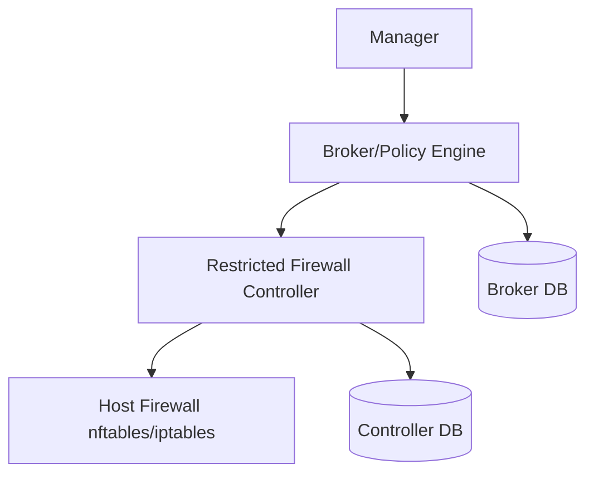

# Phase 2L.2D — Controller Security and Integration Design (DESIGN ONLY)

**Date:** 2026-11-02  
**Status:** NOT READY — LIVE FIREWALL INTEGRATION NOT AUTHORIZED  
**Scope:** Documentation/design only. No implementation, no live operations.

## 1) Architecture and Trust Boundaries

### Flow
Manager → Broker → Restricted Controller → Host Firewall

### Responsibilities
- **Manager (Django):** User/instance/challenge orchestration. Must not have direct firewall admin privileges.
- **Broker:** Policy creation, ownership resolution (via persistent stores), compilation/digest, lifecycle state, evidence validation. Trusted for policy generation but not for direct host firewall mutation.
- **Restricted Controller:** Independent validation, authorization, ownership verification, atomic installation/revocation, read-back verification, evidence generation. Must independently validate all requests.
- **Host Firewall:** nftables/iptables backend. Controlled only by restricted controller.

### Trust model
- Broker is trusted to produce valid policies but controller must re-validate ownership/digest/version.
- Caller-supplied identity/flags never establish trust.
- Controller limits broker authority via allowlists and independent checks.

## 2) Unix Domain Socket Authentication

Proposed model (design only):
- **Socket path:** e.g. `/run/flaghunt/firewall-controller.sock` (deployment-controlled)
- **Directory:** owned by controller group, mode 0750/0700
- **Socket:** owned by controller user:controller group, mode 0660
- **Peer creds:** `SO_PEERCRED` to get UID/GID/PID
- **Authorization:** allowlist of broker UID/GID; supplementary groups not implicitly trusted
- **Protection:** no caller-supplied identity headers trusted; request must still pass validation
- **Lifecycle:** per-connection auth before processing; idempotency keys prevent replay
- **Distinction:** authentication = peer identity verification; authorization = operation allowlist

## 3) Controller Privilege and Capability Model

| Model | Privileges | Attack Surface | Complexity | Limitations |
|---|---|---|---|---|
| Root-owned restricted controller | Full NET_ADMIN | High if compromised | Medium | Broad root access |
| Dedicated service account + capabilities (CAP_NET_ADMIN/CAP_NET_RAW minimal) | Minimal caps | Reduced | Higher | Capability scope varies |
| Privileged helper process | Subset | Contained if separated | High | Still privileged |
| Rootless/unprivileged | None for netfilter | Lowest | Very high | May not be feasible for nftables/iptables |

**Recommendation:** Dedicated service account with minimal capabilities, no shell, narrow allowlist, defense in depth. Sudo not recommended for broad access.

## 4) Persistent Ownership and Audit

Controller DB must store:
- policy_id, policy_version, compiled_rule_digest
- instance_id, network_id, ownership_identity
- installed rule identifiers/handles per family (IPv4/IPv6)
- installation/verification/revocation state
- verification evidence
- timestamps, operation_id, request_id

Survives restart/reboot/partial/lost responses/corruption via reconciliation. Firewall comments/labels never sufficient proof. Fail-closed on ambiguity.

## 5) nftables Integration Design

- Dedicated table/chain with controller ownership markers
- Separate IPv4/IPv6 rule sets
- Atomic transactions where possible; rollback on failure
- Read-back verification of installed rules
- Ownership validation before removal
- Careful ordering with Docker chains (DOCKER-USER/nftables)
- Default-deny egress, explicit DNS, conntrack considerations
- Revocation idempotent, never delete unowned rules
- Assumptions require host/Docker version testing

## 6) Docker Networking Compatibility

Consider bridge/per-instance networks, Docker forwarding chains, DOCKER-USER, IPv4/IPv6 NAT/forwarding, published ports, conntrack. Rule presence alone insufficient - must verify effective isolation.

## 7) Lifecycle and Failure Recovery

States: REQUESTED/PREPARING/INSTALLING/PARTIALLY_INSTALLED/INSTALLED/VERIFYING/VERIFIED/REVOKING/PARTIALLY_REVOKED/REVOKED/CLEANUP_PENDING/FAILED. Never promote to VERIFIED/ACTIVE without independent verification. Orphans reconciled; unknown rules untouched.

## 8) Threat Model (summary)

Key threats: compromised broker/controller/proxy/challenge, forged metadata, UDS impersonation, IPv6 bypass, DNS tunneling, SSRF/private access, races, reboot mid-install, lost response, stale conntrack - mitigated by independent validation, ownership, read-back verification, fail-closed, least privilege.

## 9) Testing Strategy

Unit (validation/auth/idempotency), integration (broker-controller contract), host-level (nftables/iptables, Docker), adversarial (bypass attempts, races, corruption). All in isolated lab.

## 10) Implementation Roadmap

Milestones (future, approval required): contract finalization, UDS skeleton (no bind), authz, controller DB schema, nftables backend prototype (lab), ownership/verification/reconciliation, integration tests, security validation.

## 11) Readiness Checklist

- [x] Design decisions documented
- [ ] Host/Docker version validation
- [ ] Privilege model approved
- [ ] UDS security review
- [ ] Lab environment prepared
- [ ] Rollback/recovery tested
- [ ] Security review complete

**NOT READY — LIVE FIREWALL INTEGRATION NOT AUTHORIZED**

## Final Report
- Files created: `docs/PHASE_2L_2D_CONTROLLER_SECURITY_AND_INTEGRATION_DESIGN.md`
- Files modified: none
- No implementation files changed
- No Docker/firewall/socket/systemd/host-network commands executed
- Major decisions: separate controller, independent validation, ownership by broker metadata not markers, read-back verification required, fail-closed
- Unresolved: privilege model, Docker/nftables interaction details, host-specific behavior
- Docs checked: all prior phases reviewed
**Status:** Phase 2L.2D complete (design only). Awaiting explicit approval.
