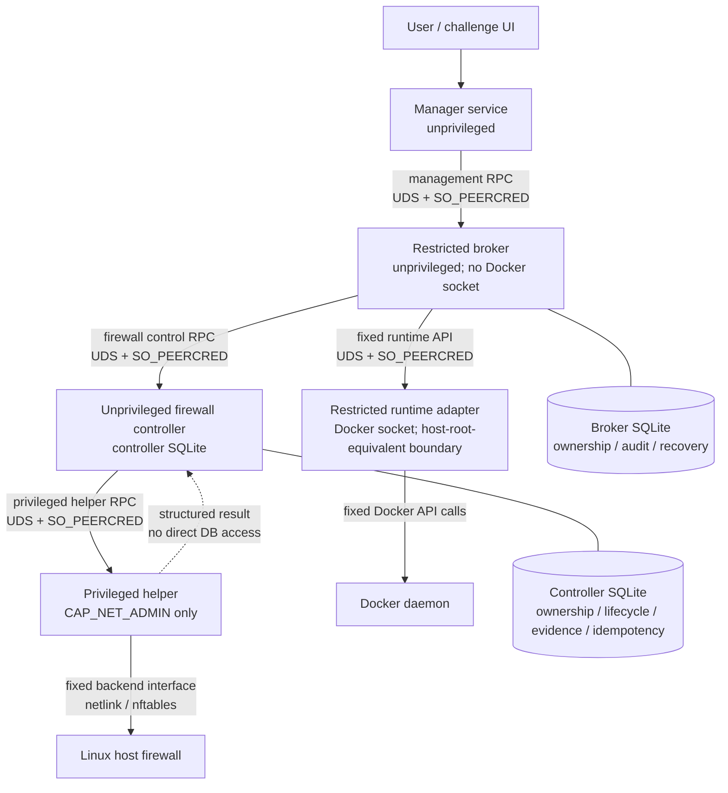

# Phase 2L.2H.1 — Real-Transport Target Architecture

**Project:** Flaghunt CTF Platform  
**Repository:** `E:\Flag-hunt\ctf-platform-be`  
**Phase:** 2L.2H.1  
**Date:** 2026-11-13  
**Status:** **DESIGN ONLY — NO IMPLEMENTATION AUTHORIZED**  
**Previous milestone:** Phase 2L.2G.3.11 — **PASS**, local mock-only scope  
**Integration gate:** **NOT READY — LIVE FIREWALL INTEGRATION NOT AUTHORIZED**  
**Remediation:** 2L.2I.2 documentation-only overlay, amended by the 2L.2I.4 consolidated
remediation; design decisions below control where they conflict with earlier text. The canonical
rule schema in Section 4.4.1 and the socket-group mechanism in Section 5.1 are normative. No
runtime control is implemented.

No real transport, UDS socket, `SO_PEERCRED` implementation, privileged helper, sudo,
capability grant, firewall/routing/NAT/conntrack/systemd/Docker operation, provisioning,
cloud resource, or production database change was performed or authorized by this document.

> **Current versus future.** This document describes the reviewed local mock implementation as
> it exists today and a proposed Linux target architecture. The target sections are design
> proposals, not implemented behavior. No current code path should be read as providing the
> future controls described here.

---

## 1. Purpose and scope

This is the top-level architecture design for a future Linux real-transport firewall controller
built on the existing control chain:

```text
Manager -> Restricted Broker -> Restricted Firewall Controller -> Privileged Helper -> Host Firewall
```

The design must preserve the security properties established by the local mock controller
(ownership authority, idempotency, lifecycle gating, evidence, reconciliation, fail-closed
authorization) while replacing mock transport and mock helper execution with kernel-authenticated
Linux transport and a narrowly privileged helper.

This document covers architecture, trust boundaries, process separation, the UDS transport
contract, and the controller/helper operation contract. It does not authorize implementation.

---

## 2. Current implementation review

### 2.1 Reviewed current components

| Component | Current implementation | Current transport | Current privilege | Persistence |
|---|---|---|---|---|
| Django manager / web app | User and instance lifecycle code; `instances/manager_client.py` is a contract-only manager client | Loopback HTTP to the manager API; provision/inspect/stop/cleanup are contract-only | Unprivileged application process | Django database |
| Manager API | `manager/app` FastAPI service with catalog and disabled provisioning routes | Loopback HTTP; Bearer token | Unprivileged process | None for lifecycle actions |
| Restricted broker | `broker/app` FastAPI service; policy, ownership, Docker adapter, audit, network ownership | Loopback HTTP `/broker/v1`; Bearer token and test-only peer headers | Unprivileged application process | SQLite broker/audit/recovery databases |
| Firewall policy engine | Offline broker policy/compiler and ownership/evidence model | In-process function calls | Unprivileged | Broker SQLite tables |
| Restricted firewall controller | `broker/firewall_controller_service` service module | Mock transport / in-process calls | Unprivileged Python process in tests | Controller SQLite ownership/idempotency/evidence database |
| Privileged helper | `MockHelperExecutor` and `MockFirewallController` | In-process mock executor | No real privilege; no host changes | In-memory mock state only |
| Host firewall backend | Mock controller behavior only | None | None | None |

### 2.2 Verified current flow

```text
Django manager
  -> (HTTP loopback contract, currently not a live lifecycle path)
Manager API
  -> (HTTP loopback, Bearer token; provision/inspect/stop/cleanup currently 503)
Restricted broker
  -> policy validation / ownership stores / mocked Docker operations
  -> no live broker -> controller route
Restricted firewall controller
  -> FirewallControllerService (strict mock authorization)
  -> ControllerOwnershipStore (SQLite)
  -> MockFirewallBackend
  -> MockHelperExecutor
  -> MockFirewallController
```

The reviewed mock controller is not wired into a live broker route. The broker's firewall
policy/compiler model and the controller's ownership/idempotency model exist, but the live
transport and host firewall backend do not.

### 2.3 Current security posture and gaps

The Phase 2L.2G.3.11 independent review concluded **PASS for the local mock-only scope** and
retained **NOT READY — LIVE FIREWALL INTEGRATION NOT AUTHORIZED**. The current gaps that matter
for this target architecture are:

- Manager-to-broker identity is an HTTP bearer token plus test-only peer headers; this is not
  kernel-authenticated peer identity.
- Broker-to-controller has no real transport. The controller service is called in-process.
- The controller's strict authorization expects `peer_uid`/`peer_gid` in the request object;
  the mock transport injects them. Request JSON must never become the identity source in the
  real architecture.
- The helper is a mock executor. It has no process isolation, no kernel peer credentials, no
  Linux capabilities, and no real firewall operations.
- No nftables/iptables backend, Docker integration, systemd units, service accounts, socket
  permissions, or deployment controls exist.
- SQLite is single-host and currently stores only mock evidence. Real backend transaction
  evidence and per-family state are not yet modeled.
- Known residual input-validation, digest-constraint, exception-context, and full-scan
  limitations remain open and are carried into the risk register in 2H.2/2H.5.

The controller's current mock authorization and the broker's test peer headers are **not**
evidence of operating-system authentication and must not be used as the live design.

### 2.4 Carried residual dependencies

The following residuals remain open and are not resolved by this architecture:

- RR-01 `request_id`, RR-02 `operation_id`, RR-03 `idempotency_key`: require mock-layer
  canonical validation plus real-transport/schema validation; DB constraints are defense in depth.
- RR-04 non-SQLite-range/wrong-type `policy_version`: requires application rejection, transport
  validation, and a database type/range constraint.
- RR-05 full-scan reconciliation: requires a controller coverage design and tests across all
  non-terminal/owned states.
- RR-06 (I-3.9-01) missing digest DB `CHECK`: requires a database migration plus continued
  application/helper validation.
- RR-07 (I-3.9-03) retained exception `__context__`: requires error-sanitization, transport, and
  deployment/logging controls and further investigation of exception paths.

The informational residuals I-07, I-08, and I-09 also remain open and are carried by every
standalone architecture document (full register in 2H.2 Section 6):

- **I-07 — Broader identifier/field scope.** Affected components: mock transport, broker request
  validation, controller validator, helper contract, and ownership-reference fields. Security
  impact: malformed or ambiguous identifiers/fields can bypass the narrower canonical gate or
  produce inconsistent idempotency/ownership binding. Required mitigation: apply the frozen
  identifier/field rules at every entry point and add universal negative tests. Owner: 2H.1
  implementation workstream. Status: **OPEN — carried**. Closure evidence: every transport,
  controller, helper, and persistence entry point rejects unknown/ambiguous fields and validates
  all identifiers with the same canonical rules.
- **I-08 — Raw `BrokerDBError` on non-failure paths.** Affected components: broker persistence and
  controller error paths. Security impact: SQLite text, paths, or exception context can leak to a
  client or audit sink. Required mitigation: a sanitized error mapper on every persistence path,
  with bounded registry codes. Owner: broker persistence workstream. Status: **OPEN — carried**.
  Closure evidence: transport/helper boundaries never return raw database errors; unknown state is
  `uncertain`, and tests cover success-path and non-failure-path exceptions.
- **I-09 — `strict_auth=False` legacy footgun.** Affected components: controller constructed in
  mock/test mode. Security impact: a production construction can select a provider that authorizes
  any valid dictionary without kernel peer identity. Required mitigation: remove the option from
  the live path; keep a test-only provider outside production imports; production construction
  requires `TrustedPeerIdentity`. Owner: controller implementation workstream. Status: **OPEN —
  carried**. Closure evidence: no production import/path can set `strict_auth=False`; construction
  without trusted identity fails closed, with an import and negative-configuration test.

The detailed classification is in `PHASE_2L_2H_2_THREAT_MODEL_AND_TRUST_BOUNDARIES.md` Section 6.

---

## 3. Proposed target architecture

### 3.1 Architecture diagram



In the target, the manager-to-broker edge is **fixed by this design as a direct-bind UDS with
`SO_PEERCRED`**. There is no loopback HTTP fallback in the target. The target broker has **no Docker
socket access**; all container lifecycle operations go through the separately isolated runtime
adapter. That adapter is a high-risk host-root-equivalent boundary because it can call the rootful
Docker daemon; the residual is explicit and is not attributed to the broker or the firewall chain.

### 3.2 Component responsibilities

#### A. Manager

- Remains responsible for challenge-instance lifecycle requests and user-facing authorization.
- Must not receive unrestricted host firewall permissions, helper socket access, or Docker
  administrative access.
- Communicates through the restricted broker boundary only.
- Sends validated, bounded requests with request/operation identifiers and idempotency keys.
- Never supplies authoritative firewall ownership identity, rule text, executable paths, chain
  names, or capability claims.

#### B. Restricted broker

- Validates manager requests against supported operations, resource policy, and broker-owned
  catalog/ownership state.
- Resolves authoritative resource ownership from broker persistence and compiler state.
- Does not receive unrestricted host privileges and cannot execute arbitrary shell commands.
- Cannot bypass controller authorization; the controller independently validates peer identity,
  operation allowlist, ownership, and lifecycle state.
- Has **no Docker socket, no Docker group membership, and no general Docker API access**. It may
  request only fixed, catalog-bound lifecycle operations from the runtime adapter over a separate
  UDS. Container creation, networking, storage, and resource decisions are revalidated by that
  adapter; the broker cannot supply arbitrary images, mounts, capabilities, commands, or host
  namespaces.
- Persists durable broker intent and audit state; never treats a controller response as success
  without the controller's evidence-gated result.

#### C. Unprivileged firewall controller

- Runs without unrestricted administrative privileges and without `CAP_NET_ADMIN`.
- Owns the authoritative controller SQLite database for firewall ownership, lifecycle,
  idempotency, evidence, and audit.
- Serves broker requests over a dedicated UDS and verifies the kernel peer identity.
- Validates every request, operation, canonical identifier, digest, address family, and ownership
  binding before any store read/write or helper call.
- Maintains durable intent, performs lifecycle CAS, records evidence, and reconciles on restart.
- Does not execute shell commands, arbitrary binaries, or user-controlled firewall rule text.
- Calls only the privileged helper, using the helper's fixed operation contract.

#### D. Privileged helper

- Has only the privilege required for approved firewall operations (`CAP_NET_ADMIN` expected;
  exact set must be validated in the host lab).
- Accepts only a fixed enum of operations and a strict schema; rejects unknown operations,
  unsupported fields, and caller-supplied identity/authorization claims.
- Does not accept arbitrary command strings, shell arguments, executable paths, chain names, or
  user-controlled firewall expressions.
- Verifies kernel peer credentials against a fail-closed UID/GID allowlist.
- Performs narrowly scoped backend changes and independent read-back.
- Returns structured, bounded, sanitized results and errors.
- Never treats a caller-provided UID/GID, "verified" flag, or "trusted" claim as authentication.
- Has no direct access to the controller/broker databases and no shell.

#### E. Restricted runtime adapter (new in 2L.2I.2)

- Runs as a separate `flaghunt-runtime` service with its own UID/GID and a narrowly scoped Docker
  socket grant. It is **not** the broker, manager, controller, or helper.
- Exposes only fixed operations: create/start/inspect/stop/remove a catalog-bound challenge
  instance; no generic Docker passthrough, exec, image pull, network-admin, volume, or daemon
  configuration operation.
- Resolves the image and all container settings from a read-only catalog manifest keyed by
  `catalog_id`; the caller never supplies an image name, digest, command, mount, capability, device,
  network mode, or privileged flag.
- Verifies ownership labels and catalog/spec digest before every mutating operation; refuses
  unmanaged or mismatched containers.
- Applies fixed restrictions: pinned image digest, non-root user, no privileged mode, no host
  network/PID/IPC/UTS namespaces, no host bind mounts, no devices, drop all capabilities, no new
  privileges, read-only root filesystem where compatible, bounded tmpfs, seccomp/AppArmor, CPU,
  memory, PID, and lifetime limits, and an internal network with no arbitrary egress.
- Because the rootful Docker API is host-root-equivalent, a compromised runtime adapter is a
  high-risk residual. The design does **not** claim that a proxy removes that authority; it removes
  the authority from the broker and confines the residual to a separate, audited, fixed-operation
  service. If that residual is not acceptable, the only compliant alternative is to remove online
  Docker daemon access entirely and use an externally isolated runtime.

### 3.3 Trust boundaries

| Boundary | What crosses | Required control |
|---|---|---|
| User/Manager boundary | User intent, instance identity, manager authorization | Existing Django/manager authorization; broker validation |
| Manager -> Broker | Management RPC request | Direct-bind UDS, `SO_PEERCRED` UID/GID allowlist, exact schema, no HTTP fallback |
| Broker -> Controller | Firewall ownership/policy operation | UDS, `SO_PEERCRED`, UID/GID allowlist, strict schema, controller ownership authority |
| Broker -> Runtime adapter | Fixed container lifecycle operation | UDS, `SO_PEERCRED`, UID/GID allowlist, fixed catalog-bound operation set, no Docker credentials in broker |
| Runtime adapter -> Docker | Fixed Docker API calls | Separate host-root-equivalent boundary; fixed endpoints and settings; no generic passthrough |
| Controller -> Helper | Narrow firewall operation | UDS, `SO_PEERCRED`, UID/GID allowlist, fixed enum, strict schema, ownership markers |
| Helper -> Kernel | Netfilter changes | Only helper has `CAP_NET_ADMIN`; fixed backend interface; read-back |
| Service -> SQLite | Ownership/evidence/idempotency | Filesystem permissions; one writer process; SQLite integrity checks; no shared database |
| Controller -> Operator | Audit/health | Sanitized audit, bounded errors, least-privilege monitoring group |

Detailed adversarial analysis is in `PHASE_2L_2H_2_THREAT_MODEL_AND_TRUST_BOUNDARIES.md`.

### 3.4 Process and privilege matrix

| Process | Service user (proposed UID/GID) | Linux capabilities | Socket role | Docker authority | Read/write data | Can alter firewall |
|---|---|---|---|---|---|---|
| Manager service | `flaghunt-manager` (4600/4600) | None | Broker client | None | Manager/Django data; no controller DB | No |
| Restricted broker | `flaghunt-broker` (4601/4601) | None | Manager server; controller client; runtime-adapter client | **None** (no socket/group) | Broker SQLite; no controller DB | No |
| Firewall controller | `flaghunt-fwcontroller` (4602/4602) | None | Broker server; helper client | None | Controller SQLite; helper socket | No |
| Privileged helper | `flaghunt-fwhelper` (4603/4603) | `CAP_NET_ADMIN` only (conditional, lab-validated) | Controller server | None | Runtime/log only; no controller DB | Yes, through fixed backend |
| Runtime adapter | `flaghunt-runtime` (4604/4604) | None | Broker server | **Rootful Docker socket** (host-root-equivalent) | Runtime/catalog/audit; no firewall socket | No direct firewall API; Docker may affect host networking |
| Host kernel/firewall | kernel | n/a | n/a | n/a | Kernel state | n/a |
| Operator/monitor | `flaghunt-monitor` (4605/4605) | None | Read-only metrics/audit access | None | Logs/metrics | No |

The helper is the only process intended to hold `CAP_NET_ADMIN`. The controller and broker remain
entirely unprivileged with respect to host firewall mutation. The runtime adapter is a separate,
explicitly high-risk Docker boundary; it has no firewall-control socket and cannot call the helper.
These numeric IDs are proposed allocations. Deployment must verify they are unused, allocate them
consistently, and record them in the host inventory before services start.

**Current-code boundary (N-04/T-27).** This matrix is the target, not the current implementation.
`broker/app/dependencies.py` still constructs `BrokerDockerAdapter` with no client and
`broker/app/routes.py` still exposes container operations through it; the adapter fails closed
without a client but its code accepts a Docker client and implements container/network operations.
`manager/app/runtime/docker_adapter.py` still exports `DockerRuntimeAdapter`, and manager tests
inject mock clients, although no manager route is wired to it in the inspected code. No
`flaghunt-runtime` service exists. The target boundary is therefore design-only and N-04 remains
open until the adapters are removed/relocated and authority tests prove no broker or manager
Docker access.

---

## 4. Communication protocol proposal

### 4.1 Three protocol classes, one frozen contract

**Decision (2L.2I.2):** the target has exactly three protocol classes over the same framed, typed
envelope: `management`, `firewall_control`, and `runtime`. There is **no loopback HTTP fallback**
in the target.

1. **Management RPC** (`protocol_class=management`) — manager to broker, direct-bind UDS with
   `SO_PEERCRED`. Authentication is the kernel peer identity plus the broker's operation/resource
   authorization. The old Bearer token and `X-Broker-Peer-*` test headers are removed from the
   target; they are not accepted as authority and must not be enabled in a live path.
2. **Firewall control RPC** (`protocol_class=firewall_control`) — broker to controller and
   controller to helper, direct-bind UDS with `SO_PEERCRED` on both ends. No HTTP headers, JSON
   identity fields, query parameters, or proxy metadata establish identity.
3. **Runtime adapter RPC** (`protocol_class=runtime`) — broker to the separate runtime adapter for
   fixed container lifecycle operations. It uses the same envelope and UDS authentication rules, but
   its operation allowlist is `RUNTIME_*` only and it has no firewall-control operations. It is not a
   path to the helper.

All three classes use the canonical envelope, framing, ID rules, error registry, size limits, and
version behavior below. The only difference is `protocol_class` and the operation allowlist.

### 4.2 Canonical request and response envelope

The protocol name is `flaghunt-local`. The frozen schema version is `2L.2I.2`. The envelope is
normative; `policy` is not a second nested object outside `payload`.

Canonical request:

```json
{
  "protocol": "flaghunt-local",
  "schema_version": "2L.2I.2",
  "message_type": "request",
  "protocol_class": "firewall_control",
  "request_id": "req-01HZX8Y4T7K2M9P0Q1R2S3T4V5",
  "operation_id": "op-01HZX8Y4T7K2M9P0Q1R2S3T4V5",
  "idempotency_key": "idem-01HZX8Y4T7K2M9P0Q1R2S3T4V5",
  "operation": "INSTALL_POLICY",
  "deadline_ms": 5000,
  "payload": {
    "policy_id": "policy-01HZX8Y4T7K2M9P0Q1R2S3T4V5",
    "policy_version": 1,
    "ownership_reference": "own-01HZX8Y4T7K2M9P0Q1R2S3T4V5",
    "instance_id": "instance-01HZX8Y4T7K2M9P0Q1R2S3T4V5",
    "network_id": "network-01HZX8Y4T7K2M9P0Q1R2S3T4V5",
    "canonical_policy_digest": "64-lowercase-hex",
    "compiled_rule_digest": "64-lowercase-hex",
    "required_families": ["ipv4", "ipv6"],
    "rules": []
  }
}
```

Canonical response:

```json
{
  "protocol": "flaghunt-local",
  "schema_version": "2L.2I.2",
  "message_type": "response",
  "protocol_class": "firewall_control",
  "request_id": "req-01HZX8Y4T7K2M9P0Q1R2S3T4V5",
  "operation_id": "op-01HZX8Y4T7K2M9P0Q1R2S3T4V5",
  "status": "ok",
  "result": {},
  "error": null,
  "server": {
    "service": "flaghunt-fwhelper",
    "version": "0.1.0",
    "backend": "nftables"
  }
}
```

`status` is exactly `ok`, `error`, or `uncertain`. `error` is `null` on `ok`; otherwise it is
`{"code": "<REGISTRY_CODE>", "message": "<sanitized bounded text>", "details": {}}`. The
`message` is informational only; clients branch on `code`, never on message text. `uncertain`
means a mutation may have happened and is **never** success.

Identity is never in the envelope. The accepted socket's `SO_PEERCRED` is the authentication
source. A claimed `controller_id`, `peer_uid`, `peer_gid`, `pid`, `verified`, or `trusted` field is
not part of the schema and causes rejection if present.

### 4.3 Frozen protocol rules

- The only accepted protocol is `flaghunt-local`; the only accepted schema version is `2L.2I.2`.
  There is no negotiation: a mismatch returns `UNSUPPORTED_SCHEMA_VERSION` or
  `UNSUPPORTED_PROTOCOL` and performs no operation.
- `protocol_class` is exactly `management`, `firewall_control`, or `runtime`. The operation must
  belong to that class's allowlist.
- Required envelope fields are exactly `protocol`, `schema_version`, `message_type`,
  `protocol_class`, `request_id`, `operation_id`, `idempotency_key`, `operation`, `deadline_ms`,
  and `payload`. `message_type` is `request` or `response`.
- `request_id`, `operation_id`, and `idempotency_key` are strings matching
  `\A[A-Za-z0-9][A-Za-z0-9._:-]{0,127}\Z`. No numeric, boolean, list, empty, whitespace,
  control-character, or overlong value is accepted. The parser must not coerce.
- `request_id` identifies one request; `operation_id` identifies one operation attempt and must be
  unique per attempt; `idempotency_key` is stable across retries. Idempotency keys are **globally
  unique per receiving service**, across all operations, not scoped to an operation type. Reusing a
  key with a different canonical payload, operation, ownership, or authenticated principal is an
  `IDEMPOTENCY_CONFLICT`.
- `policy_version` is a non-negative signed 64-bit integer (`0 <= v <= 2^63-1`); booleans, floats,
  numeric strings, and out-of-range values are rejected.
- `deadline_ms` is an integer in `1..120000`; units are milliseconds. The server enforces its own
  hard deadline `min(deadline_ms, server_cap)`. The legacy helper field `timeout_ms` is not
  accepted by the target; migration maps it to `deadline_ms`.
- `ownership_reference` is the only authoritative ownership field. `ownership_record_id` is not
  accepted in the target; accepting both would permit conflicting values. Unknown fields and
  duplicate JSON keys are rejected.
- Digests are exactly 64 lowercase hexadecimal characters (`[0-9a-f]{64}`). The target normalizes
  no case, whitespace, or truncation.
- Request and response maximum is 65,536 bytes each; individual operations may impose a lower
  bound. There is no compression, streaming, multipart body, or executable content.
- Framing is one 4-byte unsigned big-endian length followed by exactly that many UTF-8 bytes. The
  receiver rejects zero, less than the minimum, greater than the maximum, truncated, trailing,
  invalid UTF-8, invalid JSON, duplicate-key, and non-object-root frames.
- Exactly one request and one response per connection in the first implementation; the server
  closes after the response. No pipelining, keep-alive, or connection reuse. Any future persistence
  requires a new schema version and a new review.
- No implicit retries. A timeout, reset, missing response, or ambiguous backend result yields
  `uncertain`; the caller must read back/reconcile, never infer success.
- Unknown operations are rejected before ownership resolution or backend access. Unknown fields are
  rejected before dispatch. Unknown protocol classes are rejected.
- Error codes come only from the registry in Section 4.4. Raw SQLite text, filesystem paths,
  Python tracebacks, exception context, backend command text, and request bodies are never
  returned or audited. `error.message` is bounded and sanitized; clients use `error.code`.
- The target has no compatibility mode for `2L.2G.3` or the current flat controller request. The
  mock contract is a separate test adapter; the live target rejects it. A version change is a
  reviewed breaking change, not silent dual acceptance.

### 4.4 Frozen operation contract and error registry

**Firewall-control operations (`protocol_class=firewall_control`):**

| Operation | Payload required | Payload optional | Semantics |
|---|---|---|---|
| `HEALTH_CHECK` | none | none | Return protocol version, service version, backend, supported families; no mutation, no ownership input |
| `INSTALL_POLICY` | `policy_id`, `policy_version`, `ownership_reference`, `canonical_policy_digest`, `compiled_rule_digest`, `required_families`, `rules` | `instance_id`, `network_id`, `compiled` | Install one owned policy after ownership/conflict checks; read back before success |
| `INSPECT_POLICY` | `policy_id`, `policy_version`, `ownership_reference` | `required_families`, `compiled_rule_digest` | Read-only exact inspection of the owned object |
| `VERIFY_POLICY` | `policy_id`, `policy_version`, `ownership_reference`, `compiled_rule_digest` | `required_families` | Read back and compare normalized ownership/digest; evidence input only |
| `REVOKE_POLICY` | `policy_id`, `policy_version`, `ownership_reference` | `compiled_rule_digest` | Remove only matching owned rules; no success without absence read-back |
| `REMOVE_STALE_POLICY` | `policy_id`, `policy_version`, `ownership_reference` | `compiled_rule_digest` | Remove one stale owned policy; reject unowned/unknown; controller has already authorized staleness |
| `RECONCILE_PENDING_OPERATIONS` | `policy_id`, `policy_version`, `ownership_reference` | `required_families` | Read-only inspection of one owned policy; full scan remains controller orchestration |

`rules` is a typed array of at most 256 entries. Its only normative definition is Section 4.4.1.
No other document may independently redefine rule fields, defaults, protocol support, or CIDR
scope. The `compiled` value is a data-only mirror of the same canonical rules, bounded to depth 6
and 4096 characters per string; it is never executed and cannot add policy meaning.

#### 4.4.1 Canonical firewall rule schema (`rule-schema-v1`)

This section is the single canonical rule contract for the transport envelope, broker request,
controller request, helper operation, nftables/iptables backend mapping, policy persistence, and
read-back comparison. A layer may reject a rule; no layer may add a default field, widen a CIDR,
infer a direction, or change protocol/port meaning.

**Rule object.** `INSTALL_POLICY` requires a non-empty `rules` array (1..256). A rule has exactly
these eight fields; unknown, duplicate, or missing fields are rejected:

| Field | Type | Required | Permitted value / validation |
|---|---|---|---|
| `family` | string | yes | `ipv4` or `ipv6`; no `both`, mapped, or inferred family |
| `direction` | string | yes | `ingress` or `egress`; no bidirectional/implicit default; two rules are required for both directions |
| `protocol` | string | yes | `tcp` or `udp` only in v1; `any`, `icmp`, `icmpv6`, SCTP, and all other values are `UNSUPPORTED_RULE` |
| `source_cidr` | string | yes | Canonical network CIDR, strictly within the ownership record's owned challenge network |
| `destination_cidr` | string | yes | Canonical network CIDR, strictly within the same owned challenge network |
| `port_start` | integer | yes | Decimal integer 1..65535; booleans, floats, strings, and `0` are rejected |
| `port_end` | integer | yes | Decimal integer 1..65535 and `>= port_start`; no implicit whole range |
| `action` | string | yes | `accept` or `drop`; no reject/log/continue/queue action |

`family` must appear in the request's sorted, duplicate-free `required_families`; every required
family must have at least one rule. A missing family is rejected rather than filled from a host
default. `direction` is semantic, not a backend hint: `ingress` treats `source_cidr` as the external
side and `destination_cidr` as the protected side; `egress` reverses that interpretation. Both
CIDRs must remain inside the owned challenge network in v1, so a rule cannot create arbitrary
internet, host, LAN, metadata, or management-plane reachability.

**CIDR and protocol rules.**

- IPv4 uses dotted decimal with a prefix length 0..32. Leading zeroes, host bits set, whitespace,
  zones, and non-canonical text are rejected, not silently masked.
- IPv6 uses RFC 5952 lowercase compressed text with a prefix length 0..128. Brackets, zone IDs,
  whitespace, uppercase hex, and IPv4-mapped forms are rejected.
- `/0`, unspecified, loopback, link-local, multicast, reserved, benchmark, documentation, and
  metadata ranges are rejected even if an ownership record is malformed. A CIDR must be wholly
  contained by the owned challenge network; partial overlap is rejected.
- `tcp` and `udp` are the only v1 protocols. A full `1..65535` `accept` range is rejected; a full
  range `drop` is permitted only as an explicit deny within the owned CIDR scope.
- DNS is not a separate field or protocol. A DNS rule is an explicit `udp` or `tcp` rule whose
  destination is the approved in-scope resolver and whose port is 53. No wildcard resolver, search
  domain, or implicit DNS permission exists. If an approved resolver cannot be represented by this
  in-scope CIDR/port form, the policy is rejected in v1.
- Connection state is not a rule field and `established` is not an action. The backend may use
  connection tracking only for return traffic of a flow that this canonical rule already accepts;
  it may not install a global established/related accept that bypasses the rule set.
- **ICMP/ICMPv6 are explicitly out of `rule-schema-v1`.** This supersedes the earlier 2H.3
  "optional ICMP" sentence. A future schema version that adds ICMP must define type/code,
  ownership, and approval fields; v1 rejects ICMP rather than guessing a type or allowing all ICMP.

**Normalization and ambiguity.**

- The rules array order is preserved; rules are never sorted because ordering can affect backend
  evaluation. The canonical JSON uses sorted object keys, no insignificant whitespace, UTF-8,
  lowercase hex, and decimal integers. No floats, booleans, nulls, NaN/Infinity, duplicate keys, or
  non-string keys are allowed in the canonical policy body.
- CIDR text is normalized only at the representation level (for example IPv6 case/compression);
  host bits and prefixes are never changed. Ports are never widened or defaulted.
- Identical duplicate rules are rejected. Two rules with the same family/direction/protocol and
  overlapping source/destination/port matches but different actions are `AMBIGUOUS_RULE`;
  overlapping rules with the same action are permitted only when their order is preserved and the
  backend can read them back exactly.
- A rule is rejected if the backend cannot represent it exactly in both required families. The
  helper does not drop, merge, or approximate a rule to fit a backend.

**Digests and compiled mirror.**

- `compiled_rule_digest` is SHA-256 over the canonical JSON serialization of the `rules` array,
  preserving array order. `canonical_policy_digest` is SHA-256 over the canonical policy object
  containing the policy and ownership identifiers plus `required_families` and `rules`; it does not
  include the digests themselves, idempotency key, deadline, operation, or peer identity.
- If `compiled` is present it must be an object with exactly `schema_version` (`2L.2I.2`) and
  `rules`, where `compiled.rules` canonicalizes byte-for-byte to the top-level `rules`. Any other
  key, a different rule set, or a different digest is `INVALID_RULE`; `compiled` is never executed
  and never authorizes a policy.

**Layer mapping and versioning.**

| Layer | Canonical representation | Prohibited behavior |
|---|---|---|
| Transport | JSON `rules` objects with the eight fields above; unknown/identity fields rejected | Inferring identity, direction, family, protocol, or ports |
| Broker | Forwards the same canonical policy fields after envelope/ownership authorization | Rewriting rules for manager convenience or accepting legacy `2L.2G.3` fields |
| Controller | Validates, persists the canonical JSON plus digest, and passes the same `rules` to the helper | Storing a second rule language or trusting `compiled` without comparison |
| Helper | Revalidates the same eight fields and ownership/marker binding before backend access | Adding backend defaults, global state accepts, or silently dropping a rule |
| Backend | Maps `family`/`direction`/`protocol`/CIDRs/ports/action directly to a fixed nftables or iptables representation | Supporting a field the canonical schema does not define; accepting host/LAN/metadata destinations |
| Persistence/read-back | Stores and compares the canonical JSON and digest; serializes observed rules back into the same eight fields | Reconstructing policy from a lossy summary or treating a handle alone as identity |

The protocol schema version is `2L.2I.2`; the rule schema is `rule-schema-v1`. A future field,
protocol, or ICMP extension requires a new reviewed schema version and a new digest domain. There is
no silent dual acceptance, no per-rule version negotiation, and no compatibility mode for the
current flat controller/helper contracts. Invalid or ambiguous input returns `INVALID_RULE`,
`UNSUPPORTED_RULE`, or `AMBIGUOUS_RULE` from the registry; `UNSUPPORTED_PROTOCOL` remains reserved
for the envelope protocol class.

**Management operations (`protocol_class=management`):**

| Operation | Payload required | Payload optional | Semantics |
|---|---|---|---|
| `HEALTH_CHECK` | none | none | Broker liveness/readiness |
| `PROVISION_INSTANCE` | `instance_id` (positive int), `challenge_id` (positive int), `catalog_id` | `duration_seconds`, `container_port` | Validate catalog/resource policy; request runtime adapter; never accept arbitrary image/mount/command |
| `INSPECT_INSTANCE` | `instance_id` | none | Read-only state/ownership inspection |
| `STOP_INSTANCE` | `instance_id` | none | Stop only a broker-owned instance; idempotent |
| `CLEANUP_INSTANCE` | `instance_id` | none | Remove only a broker-owned instance and owned network/storage |

The management operation set is deliberately narrow. Catalog lookup and user authentication stay
in the manager. The broker re-resolves `catalog_id` against its immutable catalog and rejects an
unapproved image or profile. Container/image/volume fields are not part of this payload.

**Runtime-adapter operations (`protocol_class=runtime`):** `RUNTIME_CREATE_INSTANCE`,
`RUNTIME_START_INSTANCE`, `RUNTIME_INSPECT_INSTANCE`, `RUNTIME_STOP_INSTANCE`, and
`RUNTIME_REMOVE_INSTANCE`. Their payloads contain `instance_id`, `challenge_id`, `catalog_id`, and
the broker-resolved `spec_digest`; never an arbitrary image, command, mount, capability, device,
privileged flag, host namespace, network mode, or volume path. The adapter constructs the Docker
configuration from its own read-only catalog and verifies ownership labels.

**Error-code registry (closed set for `2L.2I.2`):**

`INVALID_REQUEST`, `MALFORMED_FRAME`, `REQUEST_TOO_LARGE`, `UNSUPPORTED_PROTOCOL`,
`UNSUPPORTED_SCHEMA_VERSION`, `UNKNOWN_OPERATION`, `UNKNOWN_FIELD`, `DUPLICATE_FIELD`,
`INVALID_ID`, `INVALID_DIGEST`, `INVALID_POLICY_VERSION`, `INVALID_DEADLINE`, `INVALID_RULE`,
`UNSUPPORTED_RULE`, `AMBIGUOUS_RULE`, `UNAUTHORIZED_PEER`,
`UNAUTHORIZED_OPERATION`, `OWNERSHIP_UNKNOWN`, `OWNERSHIP_MISMATCH`, `IDEMPOTENCY_CONFLICT`,
`BACKEND_UNAVAILABLE`, `BACKEND_REJECTED`, `VERIFY_FAILED`, `UNCERTAIN`, `TIMEOUT`,
`SERVICE_UNAVAILABLE`, `INTERNAL_ERROR`.

`INTERNAL_ERROR`, `BACKEND_UNAVAILABLE`, and `SERVICE_UNAVAILABLE` are sanitized and do not reveal
whether a write occurred. `UNCERTAIN` is used whenever the receiver cannot prove the backend state.
The registry is additive only within a schema version; removing or changing a code is a breaking
change.

The helper must not be asked to enumerate or mutate arbitrary host rules. Full-scan reconciliation
is a controller orchestration concern over its own ownership records, not a helper privilege to
scan and delete unrelated host firewall state.

### 4.5 Validation order

The target validation order is:

1. Accept connection; obtain `SO_PEERCRED`; construct an immutable trusted identity context; verify
   peer UID/GID allowlist. This happens before any request bytes are parsed.
2. Enforce connection limit and deadline.
3. Read bounded frame, verify size and canonical schema.
4. Validate protocol, schema version, operation class, and operation enum.
5. Validate required fields, types, canonical identifiers, digest, ranges, families, duplicate
   keys, and forbidden identity/authorization fields. The identity context is not merged into the
   request and cannot be overridden by it.
6. Resolve authoritative ownership in the controller (for broker->controller) or verify the
   ownership marker/reference in the helper (for controller->helper).
7. Reject if ownership is missing, mismatched, unowned, corrupt, or in an incompatible state.
8. Execute only the narrow operation; never construct a command from caller text.
9. Read back backend state through the fixed backend interface.
10. Return a structured result; controller persists evidence and completes idempotency only after
    its own validation. Audit attribution uses the trusted identity context, not request fields.

---

## 5. Linux UDS transport and authentication design

### 5.1 Socket paths and permissions

Proposed target layout (not created by this phase):

**Decision (2L.2I.2, completed by 2L.2I.4): direct bind, server-owned setgid directory, client
group traversal.** The socket directory is owned by the server user, grouped to the single client
service, and mode **`2750`** (setgid directory; owner `rwx`, client group `r-x`, no other access).
The setgid bit is part of the security mechanism, not cosmetic: a socket created by the server
inherits the directory's client group even though the server is not a member of that group. The
server therefore has the directory write permission required to create, replace, and remove its
own socket; the client has group read/execute access for traversal and connection but no directory
write; it cannot create, rename, or unlink entries. The socket is mode `0660`, owner server, group
client. Directory permissions and socket permissions are both required; neither is sufficient
alone. The socket group is resolved by kernel setgid-directory inheritance; no `chown`/`chgrp` or
`CAP_CHOWN` is used.

| Socket | Server | Client | Directory owner:group / mode | Socket owner:group / mode |
|---|---|---|---|---|
| `/run/flaghunt/manager-broker/broker.sock` | Broker | Manager | `flaghunt-broker:flaghunt-manager` 2750 | `flaghunt-broker:flaghunt-manager` 0660 |
| `/run/flaghunt/broker-controller/controller.sock` | Controller | Broker | `flaghunt-fwcontroller:flaghunt-broker` 2750 | `flaghunt-fwcontroller:flaghunt-broker` 0660 |
| `/run/flaghunt/controller-helper/helper.sock` | Helper | Controller | `flaghunt-fwhelper:flaghunt-fwcontroller` 2750 | `flaghunt-fwhelper:flaghunt-fwcontroller` 0660 |
| `/run/flaghunt/broker-runtime/runtime.sock` | Runtime adapter | Broker | `flaghunt-runtime:flaghunt-broker` 2750 | `flaghunt-runtime:flaghunt-broker` 0660 |

`/run/flaghunt` is `root:root` `0755`, non-world-writable. Direct-bind servers never rely on
systemd socket activation; `systemd-tmpfiles` creates the directories with the exact owner/group/
mode before the service starts. The server verifies the directory and existing socket before bind.
No unrelated process can write another service's directory. The helper socket is inaccessible to
the manager and broker; the controller socket is inaccessible to the manager; the runtime-adapter
socket is inaccessible to the controller and helper. Socket groups are for access control, not
identity: both ends still verify `SO_PEERCRED` UID/GID.

**Group assignment mechanism (normative; N-01).**

1. Deployment creates each numeric service account with its own primary group: manager
   `4600/4600`, broker `4601/4601`, controller `4602/4602`, helper `4603/4603`, runtime
   `4604/4604`, monitor `4605/4605`. These IDs are inventory-verified and recorded; they are not
   recycled or shared.
2. For each edge, the directory owner is the **server** UID and the directory group is the
   **client** primary GID. The server is **not** added to the client group; the client is not
   added to the server group; no service relies on supplementary-group membership for socket
   access. This preserves the boundary: the server creates the path, and the client only traverses
   and connects.
3. `systemd-tmpfiles` (or an equivalent root-only deployment step) creates each child directory
   with owner/group and mode `2750`. `/run/flaghunt` is root-owned `0755`. The mode string is
   validated as setgid (`S_ISGID`), not merely as `0750`; a `0750` directory is a startup failure.
4. The server binds its socket in the setgid directory with a restrictive umask. The kernel assigns
   the directory's group to the new socket inode; the server then sets the socket mode to `0660`
   and verifies the resulting owner/group/mode. It must not call `chown`/`chgrp`, must not require
   `CAP_CHOWN`, and must not add itself to the client group. If the kernel does not assign the
   expected group (for example because the filesystem/mount does not honor setgid inheritance),
   startup fails closed; there is no fallback to a shared group, world-writable socket, `chmod 0666`,
   or supplementary-group workaround.
5. `/run` must be a filesystem that honors setgid-directory group inheritance and does not permit
   unprivileged directory replacement. The host-validation lab must prove this on the pinned
   Ubuntu/kernel release. A failed proof is a host-validation blocker, not a reason to weaken modes.
6. Unauthorized local users have no directory traverse permission (`other` is `---`) and no socket
   mode bits; they cannot connect. Root is outside this trust boundary and remains a host
   compromise, not a UDS bypass. There are no permissive ACLs, no `flaghunt` shared group, and no
   group-writable directory.
7. Ownership and mode are re-verified at every startup and after every bind with `lstat`/`fstat`:
   directory type, owner server, group client, exact `2750`, no group/other write; socket type,
   owner server, group client, exact `0660`, no symlink. A mismatch stops the service before
   readiness and is audited with bounded fields. The verifier does not repair owner/group/mode in
   place.
8. Upgrades and package changes preserve the numeric IDs and tmpfiles records. If an account or
   group is missing, or IDs drift, deployment fails closed; it does not recreate a service under a
   new UID or reuse another service's group. Changing an edge's owner/group/mode requires a
   reviewed deployment change and revalidation of every peer allowlist.
9. Restart follows Section 5.2: tmpfs clears stale sockets; tmpfiles reasserts `2750`; the server
   re-binds and re-verifies. A pre-existing live socket is never unlinked; a stale socket is
   unlinked only after the owner/group/mode/type checks and a failed live probe.

The process permission matrix is:

| Process | Directory access | Socket access | Effective reason |
|---|---|---|---|
| Manager | traverse `manager-broker` | connect `broker.sock` | management client |
| Broker | write `manager-broker`; traverse `broker-controller` and `broker-runtime` | bind `broker.sock`; connect `controller.sock` and `runtime.sock` | server + two clients |
| Controller | write `broker-controller`; traverse `controller-helper` | bind `controller.sock`; connect `helper.sock` | server + helper client |
| Helper | write `controller-helper` | bind `helper.sock` | privileged server |
| Runtime adapter | write `broker-runtime` | bind `runtime.sock` | runtime server |
| Any other local UID | no access | no access | denied by directory mode and peer allowlist |

### 5.2 Socket creation, replacement, and lifecycle

Direct-bind lifecycle:

1. `systemd-tmpfiles` or the deployment process creates `/run/flaghunt` and each child directory
   with the exact owner/group/mode in Section 5.1. `/run` is a tmpfs, so reboot clears runtime
   sockets; the directory records are recreated before services start.
2. The server starts with `Requires=systemd-tmpfiles-setup.service`/`After=...`, verifies with
   `lstat` that its directory is a real directory, not a symlink, owned by the expected server UID
   and group, mode exactly `2750` with the setgid bit, and has no group/world write. It also
   verifies that every parent component is root-owned and not group/world-writable. Any mismatch is
   a startup failure; it must not chmod/chown the path or continue with a weaker path.
3. The server takes a single-instance `flock` on a server-owned lock file in the directory (or
   relies on systemd's single-instance unit) and probes any existing `*.sock` target.
4. If the target is absent, or is a dead socket owned by the expected server, the server binds a
   unique temporary socket in the same directory with umask `0077`. Kernel setgid-directory
   inheritance assigns the client group; the server sets mode `0660` and verifies the exact
   owner/group from `lstat`, without `chown`/`chgrp`. It then atomically `rename()`s the socket over
   the target. It rejects a symlink, regular file, directory, FIFO, or socket owned by another UID
   or carrying a different group. It never unlinks an arbitrary path.
5. If the target accepts a connection, another live server exists; startup fails rather than
   stealing or unlinking the live socket.
6. The server sets `FD_CLOEXEC` on accepted/listening descriptors, disables `SCM_RIGHTS` handling,
   and never passes descriptors to child processes. It accepts one request per connection.
7. On controlled shutdown, the server unlinks the target only if it is still its own socket inode.
   It never removes rules or another service's socket. On crash, the next start performs the
   dead-socket check above.
8. On reboot, the tmpfs paths are empty; tmpfiles recreates them and services bind again. A
   persistent path is not assumed.

Socket replacement is prevented by the `2750` setgid server-owned directory and exact
owner/group/mode checks. A process that can write the directory can replace the server; therefore
the directory is never world-writable, group-writable to an unrelated group, or shared between
services. The client still verifies the server's peer UID/GID after `connect()` before sending a
request. If setgid inheritance or the exact owner/group/mode cannot be proven, the service fails
closed; it never falls back to a shared-group or permissive socket.

### 5.3 Trusted kernel identity adapter (H-03)

On Linux, the transport adapter obtains credentials from the **accepted** socket with
`getsockopt(SOL_SOCKET, SO_PEERCRED)` before parsing any request bytes:

```text
struct ucred { pid_t pid; uid_t uid; gid_t gid; }
```

The immutable trusted identity is constructed only by the UDS transport adapter:

```text
TrustedPeerIdentity
  uid: uint32                 # kernel SO_PEERCRED uid
  gid: uint32                 # kernel SO_PEERCRED primary gid
  pid: uint32                 # audit/correlation only
  source: literal "SO_PEERCRED"
  connection_id: bounded transport-generated value
  bound_at: monotonic timestamp
```

The type has no public constructor from JSON/dict, no `from_request`, and no mutable fields.
The request schema has no identity fields. A request containing `peer_uid`, `peer_gid`, `peer_pid`,
`uid`, `gid`, `pid`, `caller_uid`, `caller_gid`, `caller_trusted`, `verified`, `trusted`,
`auth_identity`, `x_identity`, `source_identity`, `controller_verified`, `authorized`, or
`is_admin` is rejected with `INVALID_REQUEST`/`UNKNOWN_FIELD`; it is never stripped and silently
accepted.

Identity binding and use:

- The identity is captured once per accepted connection and stored in the per-connection context.
  A request cannot replace it. One request per connection means there is no later-request identity
  confusion.
- Authorization receives `(TrustedPeerIdentity, parsed_request)` as separate arguments. The
  service never reads identity from the request, headers, environment, or query string.
- Both UID and primary GID must be in the service's non-empty numeric allowlist. An empty list,
  missing `SO_PEERCRED`, wrong length, non-Linux platform, or mismatch denies before dispatch.
  Supplementary groups are not trusted.
- PID is audit-only. PID reuse cannot authorize. The design does not use `/proc` or a claimed PID
  for peer authorization.
- Process identity is authentication, not application authorization. The controller/broker still
  resolves ownership, operation, catalog, and lifecycle from their own durable state.
- The client also verifies the **server's** peer UID/GID after `connect()` and before sending a
  request. With direct bind, the server credentials are the service's credentials; a replaced
  socket or wrong server fails closed.
- On failure: close the connection, emit a bounded `UNAUTHORIZED_PEER` audit event with claimed
  values (if any) and the trusted values that were available, and perform no store/backend action.
  There is no fallback to HTTP, headers, tokens, or test identity.

**Test-only identity injection:** test doubles live only under the test tree and are not importable
by production entry points. There is no `strict_auth=False`, no `MockAuthorizationProvider`, no
test-only header merge, and no environment variable that injects production peer identity. A
deployment assertion fails if a test identity provider or insecure auth flag is enabled. The mock
transport remains a local test artifact and is never a target transport.

Kernel identity sequence:

```mermaid
sequenceDiagram
    participant C as Client process
    participant K as Linux kernel
    participant T as UDS transport adapter
    participant P as Request parser
    participant A as Authorization
    participant D as Operation dispatcher
    participant U as Audit/evidence

    C->>K: connect(UDS path)
    K->>T: accept(); kernel peer credentials available
    T->>K: getsockopt(SO_PEERCRED)
    K-->>T: pid, uid, gid
    T->>T: construct immutable TrustedPeerIdentity
    T->>A: verify UID/GID allowlist before request parsing
    alt identity invalid/empty/unavailable
        A-->>C: deny; close; no operation
        A->>U: sanitized auth-failure audit
    else identity accepted
        T->>P: bounded frame and exact schema
        P->>P: reject identity/unknown fields; no merge
        P->>A: (TrustedPeerIdentity, parsed request)
        A->>D: authorize operation, ownership, lifecycle
        D->>D: fixed backend/helper operation
        D->>U: audit with trusted principal + request/operation IDs
        D-->>C: canonical response
    end
```

**Numeric configuration contract:**

| Setting | Required value / rule |
|---|---|
| Config path | `/etc/flaghunt/<service>.json`, root-owned, service group, mode `0640`; not writable by the service |
| Format | Canonical JSON object; unknown keys rejected |
| `allowed_client_uids` | Non-empty sorted array of decimal integers; no strings/duplicates; UID 0 never allowed |
| `allowed_client_gids` | Non-empty sorted array of decimal primary GIDs; no strings/duplicates; GID 0 never allowed |
| `expected_server_uid/gid` | Exact numeric server identity used by the client check |
| `socket_path` | Absolute path matching Section 5.1 |
| `dir_mode` / `socket_mode` | Exactly `2750` (setgid) / `0660` for the target edges |
| Expected directory/socket group | Exact client numeric GID from the edge table; verified after tmpfiles and bind; mismatch fails closed |
| Startup check | Config owner/mode and numeric ranges verified; empty/wildcard allowlist fails closed |

Proposed allowlists: broker accepts manager `4600/4600`; controller accepts broker `4601/4601`;
helper accepts controller `4602/4602`; runtime adapter accepts broker `4601/4601`. Managers,
brokers, controllers, and the helper each verify the next server's numeric UID/GID. These are design
allocations, not created by this review.

### 5.4 Why HTTP headers and caller-supplied UID/GID cannot replace kernel identity

Headers and JSON fields are request data. Any process that can reach an HTTP endpoint can set
`X-Broker-Peer-UID`, `X-Broker-Peer-GID`, `Authorization`, or a JSON `peer_uid` field. A token can
be stolen, replayed, or leaked through logs; a loopback bind does not prove which local UID made
the connection. In contrast, `SO_PEERCRED` is populated by the kernel for the connected Unix
domain socket and is tied to the peer process credentials at connection time. It is still not
absolute protection against root, kernel compromise, or a compromised process running under an
allowed UID, but it is the correct authentication primitive for the local boundary.

The current broker's `X-Broker-Peer-*` headers are explicitly test-transport scaffolding. They
must not exist in the live firewall-controller trust path.

### 5.5 Framing, size limits, and malformed messages

Frozen framing:

- 4-byte unsigned big-endian payload length, followed by exactly that many bytes.
- Payload is UTF-8 canonical JSON (sorted keys, no duplicate keys, no NaN/Infinity, no trailing
  whitespace outside the object).
- Minimum length 1; maximum 65,536 bytes for both request and response. Per-operation limits may be
  lower. Length `0`, `> 65536`, truncated, or trailing bytes are rejected.
- Reject invalid UTF-8, invalid JSON, duplicate keys, non-object root, unknown fields, unsupported
  nested types, excessive depth, and schema mismatch.
- Reject ancillary data/`SCM_RIGHTS`; reject descriptors received on the socket. Set `FD_CLOEXEC`
  and `close-on-exec` behavior for every descriptor; never pass the accepted socket to a child.
- Close the connection after a protocol error without echoing request content.
- Audit a bounded reason code; do not log secrets, raw request bodies, SQL, paths, tracebacks, or
  exception context.

One request/response per connection is frozen for `2L.2I.2`. It makes framing, timeout, cleanup,
and identity binding simple. A later persistent connection is a new schema version and requires
ordering, no pipelining, per-request deadlines, cancellation, and re-review.

### 5.6 Timeouts and connection handling

- Server accept, read, validation, backend, and write deadlines are bounded.
- `deadline_ms` is mandatory in `1..120000` milliseconds; the server enforces
  `min(deadline_ms, server_cap)` plus an independent transport deadline. The deadline covers the
  whole request, not each read separately.
- The controller treats a timeout, connection reset, missing response, `uncertain`, or
  `INTERNAL_ERROR` as **uncertain**, not success, and reconciles with read-back.
- Connection limits and per-peer limits prevent local denial of service. One request per
  connection; a bounded worker pool; no unbounded thread/process creation.
- The helper does not spawn a shell or unbounded worker; a bounded worker model is required.
- In-flight helper operations finish or are terminated within a controlled window; partial
  backend state remains subject to reconciliation.
- The management and runtime adapter clients use the same timeout and uncertainty rules; a timeout
  never causes an automatic retry with a new idempotency key.

### 5.7 Fail-closed conditions

The connection is denied, and no backend operation is attempted, when:

- `SO_PEERCRED` cannot be obtained, has an unexpected length, or is malformed.
- UID/GID allowlists are empty, contain wildcards/zero, or do not match.
- The socket directory/socket owner, type, link status, or mode is unsafe.
- The server is not the expected direct-bind service, or the client cannot verify the server's
  peer UID/GID.
- The protocol/class/schema version, operation, framing, size, duplicate keys, unknown fields, or
  required fields are invalid.
- The ownership reference is missing, unowned, corrupt, or mismatched.
- The request contains any identity/authorization claim or ancillary descriptor.
- The helper cannot read back the backend state after a mutation; result is `uncertain`, never
  success.
- An error would require returning raw storage/backend details, exception context, or a raw request
  body.

### 5.8 Manager-to-broker decision and deployment requirements (H-04)

**Selected transport: direct-bind UDS `/run/flaghunt/manager-broker/broker.sock`.** The manager is a
non-root service; the broker is the server. Both use `SO_PEERCRED`; the manager UID/GID is exactly
`4600/4600`, the broker UID/GID is `4601/4601`. There is no HTTP listener, Bearer token, test header
path, token fallback, or loopback exception in the target.

| Requirement | Decision |
|---|---|
| Authentication | Kernel `SO_PEERCRED` on both ends; exact numeric allowlists; no caller-supplied identity |
| Authorization | Broker operation/resource policy; manager remains responsible for user authentication at TB-0 |
| Service identity | Manager `flaghunt-manager`; broker `flaghunt-broker`; separate primary groups |
| Request integrity | UDS stream + 4-byte framing + canonical JSON + duplicate/unknown-field rejection; idempotency digest binds authenticated principal and canonical payload |
| Replay protection | Unique `request_id`/`operation_id`; global-per-receiver idempotency key; conflict on different payload/operation/principal; no blind retry |
| Timeout | `deadline_ms` 1..120000; client connect/read/write deadlines; server hard cap; timeout is `uncertain` |
| Payload limits | 65,536 bytes request/response; management operations bounded and non-streaming |
| Message schema | `flaghunt-local` / `2L.2I.2`; `protocol_class=management`; operations in Section 4.4 |
| Error handling | Closed error registry; sanitized message; no raw SQL/paths/tracebacks |
| Connection lifecycle | One request/response per connection; close after response; no keep-alive/pipelining |
| Failure behavior | Missing/wrong peer, bad frame, auth failure, or timeout closes connection and audits; no operation and no fallback |
| Audit attribution | Trusted manager UID/GID/PID, request/operation/idempotency IDs, instance/resource, result/error code; no payload dump |
| Deployment | tmpfiles creates `2750` setgid directory; broker binds and inherits the manager group; manager traverses/connects; systemd `After=tmpfiles`; readiness only after peer/group/mode checks |

The existing HTTP behavior and `X-Broker-Peer-*` headers are **NOT** a transition fallback. Any
temporary HTTP compatibility would require a separate approved change, a mandatory non-empty token,
loopback-only bind, no peer headers, and an explicit removal date; it is not part of this target and
must not be enabled by default. The target implementation phase must remove the HTTP client path and
the empty-token/default configuration from the live broker route. Current code is not modified by
this document.

---

## 6. Current versus target comparison

| Aspect | Current mock implementation | Proposed target | Status |
|---|---|---|---|
| Manager -> broker | Loopback HTTP + Bearer; test peer headers; stub client | Direct-bind UDS `SO_PEERCRED`; no HTTP fallback; `flaghunt-local`/`2L.2I.2` | Design resolved; not implemented |
| Broker -> controller | In-process/no live route | UDS with `SO_PEERCRED` and fixed RPC | Design resolved; not implemented |
| Broker -> runtime adapter | Broker Docker adapter is still wired to routes but has no client; manager `DockerRuntimeAdapter` is exported but not route-wired | Broker has no Docker socket; fixed runtime adapter UDS | Design resolved; current code authority remains open (N-04/T-27) |
| Controller -> helper | In-process `MockHelperExecutor` | UDS with `SO_PEERCRED` and privileged helper | Design resolved; not implemented |
| Identity | Caller-supplied peer fields in mock transport | Immutable trusted `SO_PEERCRED` context; JSON identity rejected | Design resolved; not implemented |
| Wire protocol | Flat controller request; helper `2L.2G.3`; `timeout_ms`; differing operation names | `flaghunt-local`/`2L.2I.2`; canonical envelope; `deadline_ms`; frozen operation/error registry | Design frozen; not implemented |
| Helper privilege | None; mock in-memory state | `CAP_NET_ADMIN` only, dedicated user, hardened service | Design only; not granted |
| Docker authority | Broker Docker adapter wired but clientless; manager adapter exported but not route-wired | Removed from broker/manager; fixed runtime adapter; host-root residual remains | Design resolved; code open (N-04/T-27) |
| Firewall backend | Mock controller | nftables primary; iptables/DOCKER-USER fallback | Design only; not validated |
| Persistence | Controller SQLite mock schema | Extended SQLite with per-family state/evidence, global idempotency, constraints | Design only; not migrated |
| Recovery | Mock tests | Durable intent, read-back, restart reconciliation | Design only; not proven |
| Deployment | Windows development | Ubuntu Linux systemd services, direct-bind sockets, tmpfiles | Design only; not deployed |

The current mock behavior is usable only for local validation. It does not prove any target row.
All target rows remain unimplemented until a separately approved phase.

---

## 7. Open design decisions

**Resolved by 2L.2I.2 and completed by 2L.2I.4:** manager-to-broker transport is direct-bind UDS
with `SO_PEERCRED`; socket lifecycle is direct bind with tmpfiles-created server-owned `2750`
setgid directories and kernel-inherited client groups (Section 5.1); numeric service IDs and
allowlists are specified in Section 5.3; protocol name/version/envelope/operations/timeouts/error
codes and the canonical `rule-schema-v1` are frozen in Section 4. Supplementary-group membership is
not used for socket access, so the former supplementary-group open decision is closed in design;
host validation must still prove setgid inheritance and cross-UID deny.

Remaining decisions require a later approved design or host-lab phase; this document does not
guess them:

1. **Helper implementation:** native fixed binary versus a locked-down interpreter. Prefer a small
   fixed executable with no dynamic code loading; exact choice requires supply-chain and seccomp
   review.
2. **Single helper versus split read/inspect helper:** one `CAP_NET_ADMIN` helper is simpler; a
   separate read-only helper could reduce mutation exposure but adds process/socket complexity.
3. **nftables integration point:** exact table/chain names, hook priorities, and Docker coexistence
   must be selected in the host lab. Do not assume a hook order or priority is safe.
4. **Runtime adapter residual acceptance:** rootful Docker access makes the runtime adapter
   host-root-equivalent. The architecture removes that authority from the broker but does not
   eliminate it from the adapter. Explicit risk acceptance (or removal of online Docker daemon
   access) is required before any implementation; see 2H.2 T-27.
5. **Supplementary groups:** not used for socket access in the target. The setgid-directory
   mechanism deliberately requires no server membership in the client group. Any future use for a
   different purpose requires race-safe PID/group validation, PID-reuse analysis, and a new review.
6. **Multi-controller/HA:** SQLite and local UDS imply a single active controller per host in the
   first target. Distributed leadership/leases are not designed here.
7. **IPv6 requirement:** dual-stack parity is required for target correctness, but the host may
   have IPv6 disabled. The design must fail closed or require an explicit approved policy, not
   silently omit IPv6.
8. **Evidence trust model:** controller-written evidence is authoritative in the current model.
   Whether the helper should additionally sign read-back evidence (for example with a helper-held
   HMAC key) is open and requires key-management design.
9. **Database migration timing:** schema additions must be compatible with the existing mock
   database and must not auto-promote legacy rows.
10. **Audit durability:** controller SQLite audit versus journald/remote append-only log for helper
    audit; exact retention and tamper resistance are open.
11. **Boot-time baseline:** whether the host has an operator-owned default-deny baseline before
    the helper/controller starts, and how challenge rules are restored after boot.
12. **T-11/T-13 risk acceptance:** controller compromise and `CAP_NET_ADMIN` helper compromise
    remain High residuals; host isolation/monitoring criteria and a named acceptance authority are
    still required.

---

## 8. Document map and consistency rules

This document is one of five linked design documents:

- `PHASE_2L_2H_1_REAL_TRANSPORT_TARGET_ARCHITECTURE.md` — components, trust boundaries, UDS,
  protocol, operation contract, open decisions.
- `PHASE_2L_2H_2_THREAT_MODEL_AND_TRUST_BOUNDARIES.md` — adversary model, threat register,
  residual-risk register.
- `PHASE_2L_2H_3_FIREWALL_BACKEND_AND_PRIVILEGE_DESIGN.md` — nftables/iptables, ownership markers,
  helper privilege and hardening.
- `PHASE_2L_2H_4_PERSISTENCE_RECOVERY_AND_DEPLOYMENT_DESIGN.md` — SQLite model, migration,
  recovery, Ubuntu deployment.
- `PHASE_2L_2H_5_IMPLEMENTATION_AND_VALIDATION_ROADMAP.md` — sequence, tests, dependencies,
  go/no-go criteria.

Consistency rules for all five documents:

- The controller remains the authority for firewall ownership and evidence; the broker must not
  mutate host firewall state directly.
- The helper remains the only component with `CAP_NET_ADMIN`; the controller remains unprivileged.
- The broker has no Docker socket, Docker group membership, or generic Docker API. Runtime operations
  go through the fixed runtime adapter, which remains a separate host-root-equivalent residual.
- Manager/broker/controller/helper use direct-bind UDS with `SO_PEERCRED`; there is no live HTTP
  fallback and no caller-supplied identity authority.
- Service names, numeric IDs, socket paths/modes, protocol name/version, operation names, timeout
  field, error codes, and ownership field are exactly those in Sections 3-5. No document may use
  aliases such as `ownership_record_id` or `timeout_ms` as target fields.
- The canonical rule schema is exactly Section 4.4.1. 2H.3, 2H.4, and 2H.5 may map or persist it
  but may not redefine fields, protocol support, CIDR scope, direction, state, or DNS behavior.
- Socket directories are `2750` setgid directories with owner-server/client-group and sockets are
  `0660`; kernel group inheritance and no supplementary-group access are part of the contract.
- Current broker/manager Docker adapters are not evidence of the target boundary. N-04/T-27 remain
  open until code no longer contains reachable Docker authority outside the runtime adapter.
- No success is inferred from a sent request. `ACTIVE` and `REVOKED` require authoritative backend
  read-back and durable evidence.
- The local mock controller remains the current implementation. The target design does not
  retroactively claim that mock tests prove live security.
- The live gate remains **NOT READY — LIVE FIREWALL INTEGRATION NOT AUTHORIZED**; 2L.2I.2 and
  2L.2I.4 are documentation remediations, not implementation authorization.

---

**DESIGN COMPLETE — REAL FIREWALL IMPLEMENTATION NOT AUTHORIZED**

**NOT READY — LIVE FIREWALL INTEGRATION NOT AUTHORIZED**
