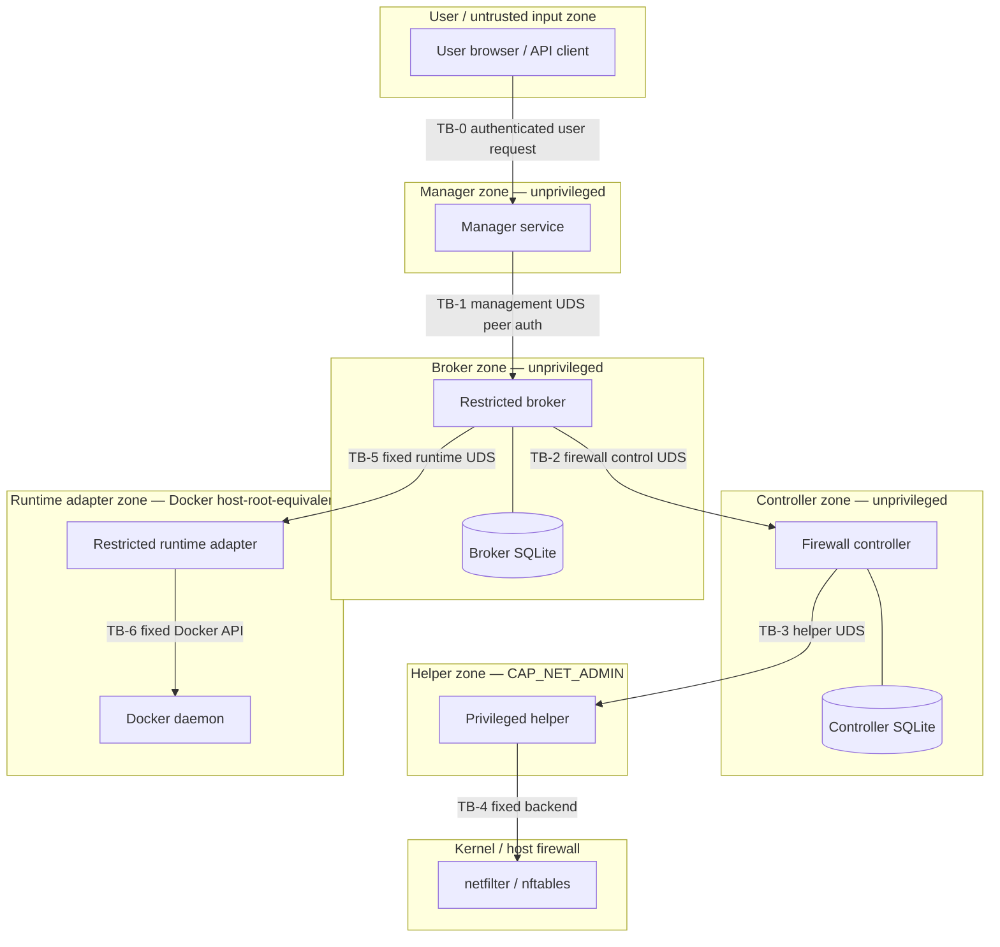

# Phase 2L.2H.2 — Threat Model and Trust Boundaries

**Project:** Flaghunt CTF Platform  
**Repository:** `E:\Flag-hunt\ctf-platform-be`  
**Phase:** 2L.2H.2  
**Date:** 2026-11-13  
**Status:** **DESIGN ONLY — NO IMPLEMENTATION AUTHORIZED**  
**Integration gate:** **NOT READY — LIVE FIREWALL INTEGRATION NOT AUTHORIZED**  
**Remediation:** 2L.2I.2 documentation-only overlay, amended by 2L.2I.4; design decisions below control where they
conflict with earlier text. No runtime control is implemented.

This threat model applies to the proposed Linux real-transport architecture described in
`PHASE_2L_2H_1_REAL_TRANSPORT_TARGET_ARCHITECTURE.md`. It does not authorize any transport,
socket, helper, privilege, firewall, Docker, systemd, or deployment change.

> **Current versus future.** The current implementation is the local mock controller/reviewed in
> Phase 2L.2G.3.11. It has no real UDS, no kernel peer authentication, no privileged helper, and no
> host firewall backend. Every target control below is a proposal. Current mock behavior is not
> evidence that the target control exists.

---

## 1. Assets and security objectives

| Asset | Security objective |
|---|---|
| Host firewall policy | Only authorized, owned, bounded policy changes; no unauthorized rule insertion, deletion, or bypass |
| Challenge/instance ownership records | Integrity and authoritative binding to policy, network, container, and generation |
| Controller lifecycle state | Durable, monotonic, evidence-gated; no false `ACTIVE`/`REVOKED` |
| Evidence and audit | Integrity, provenance, non-repudiation within the local trust model, enough detail to reconstruct decisions |
| Idempotency and operation history | No duplicate side effects, no key collision, no replay impact |
| Privileged helper capability | Narrowly scoped `CAP_NET_ADMIN`; no shell, arbitrary code, arbitrary rule text, or broad host control |
| Service identities and sockets | Only the intended client reaches each server; identity is kernel-authenticated |
| Availability | No local DoS that prevents revocation or recovery; fail closed on uncertainty |
| Information confidentiality | No host topology, paths, tokens, raw SQL, stack traces, or policy secrets in errors/audit |

The primary security objective is **correct, owned firewall policy with no unauthorized or
unverified host mutation**. A secondary objective is **fast, fail-closed revocation and recovery**.

---

## 2. Trust boundaries

### 2.1 Boundary diagram



### 2.2 Boundary table

| Boundary | Data crossing | Authentication/authorization | Main threats |
|---|---|---|---|
| TB-0 User -> Manager | User intent, session, instance identity | Existing application authentication/authorization | User spoofing, unauthorized lifecycle request |
| TB-1 Manager -> Broker | Management operation, resource identifiers | Direct-bind UDS; `SO_PEERCRED` UID/GID allowlist; no HTTP/token/header fallback | Manager compromise, request forgery, replay |
| TB-2 Broker -> Controller | Firewall policy/ownership operation | UDS `SO_PEERCRED` UID/GID allowlist; strict schema; controller ownership | Broker compromise, replay, ownership substitution |
| TB-3 Controller -> Helper | Narrow firewall operation | UDS `SO_PEERCRED` UID/GID allowlist; fixed enum; ownership markers | Compromised controller, malicious local client, socket spoofing |
| TB-4 Helper -> Kernel | Netfilter changes | Only helper holds `CAP_NET_ADMIN`; fixed backend interface | Privilege abuse, partial install, Docker interaction |
| TB-5 Broker -> Runtime adapter | Fixed catalog-bound container lifecycle | UDS `SO_PEERCRED`; fixed `RUNTIME_*` enum; no arbitrary Docker input | Broker compromise, container escape, unmanaged runtime objects |
| TB-6 Runtime adapter -> Docker | Fixed Docker API calls | Separate host-root-equivalent boundary; pinned catalog; fixed container settings | Runtime adapter compromise, Docker daemon abuse, host-root escalation |
| Service -> SQLite | Ownership, lifecycle, evidence, idempotency | Filesystem ownership/mode; single writer; integrity checks; append-only evidence | DB corruption/tampering, concurrent writers |
| Controller/Helper -> Audit | Decisions, failures, evidence references | Sanitized structured logs; separate writers; bounded disk | Log tampering, disk exhaustion, information leakage |

The **controller DB is not a shared database**. The helper does not read or write it. The broker
does not write controller ownership/evidence. This separation is a security boundary, not just a
code organization preference.

---

## 3. Identity and authentication assumptions

### 3.1 Current mock behavior

- The broker's current `X-Broker-Peer-UID`, `X-Broker-Peer-GID`, `X-Broker-Peer-User` headers are
  **test-transport scaffolding**. They are caller-supplied and are not operating-system identity.
- The controller's strict authorization consumes `peer_uid`/`peer_gid` from the request context;
  the mock transport injects those values. Direct service calls can supply them as ordinary data.
  This is the H-03 defect and is not a target design.
- The mock helper executor authorizes against an injected per-request identity. It is in-process
  and does not verify a real peer.
- The current manager client is HTTP loopback with a Bearer token; this is not kernel peer
  authentication and is not the target transport.

### 3.2 Target trusted identity architecture (H-03)

1. The UDS transport adapter obtains `SO_PEERCRED` from the **accepted** socket before parsing any
   request bytes. It constructs an immutable `TrustedPeerIdentity` containing numeric uid, gid,
   audit-only pid, source string `"SO_PEERCRED"`, a transport-generated connection ID, and a
   monotonic bind timestamp.
2. The type cannot be constructed from JSON, headers, query data, environment variables, or
   ordinary dict parsing. There is no `from_request` path.
3. The server requires both uid and primary gid to match non-empty numeric allowlists. Empty lists,
   missing credentials, wrong `ucred` length, non-Linux platforms, and malformed values deny before
   dispatch.
4. Identity is bound to the accepted connection and passed separately to authorization. It is
   never merged into the request and cannot be replaced during processing. One request per
   connection prevents later-request identity confusion.
5. Request JSON, HTTP headers, query parameters, caller environment, and claimed PIDs are **not**
   authentication. Requests containing `peer_uid`, `peer_gid`, `pid`, `uid`, `gid`,
   `caller_trusted`, `verified`, `trusted`, `authorized`, `controller_verified`, or similar fields
   are rejected, not silently stripped.
6. PID is audit/correlation only. PID reuse makes PID-only authorization unsafe.
7. Supplementary groups are not trusted initially. `SO_PEERCRED` reports the primary GID; any
   future supplementary-group use requires race-safe process validation and explicit review.
8. The client verifies the server's peer UID/GID after `connect()` and before sending a request.
   With direct bind, a replaced socket or wrong server fails closed.
9. Process identity is authentication only. Ownership, operation, resource, catalog, and lifecycle
   authorization still come from the controller/broker databases and operation allowlists.
10. Test-only identity injection lives only under the test tree and is not importable by production
    entry points. There is no `strict_auth=False`, no mock authorization provider, and no test
    header/env override in the live path. Deployment asserts that none is enabled.
11. Root, kernel compromise, and a compromised process running under an allowed UID are outside
    the authentication guarantee; they remain explicit residual risks.

### 3.3 Why HTTP headers cannot substitute for kernel identity

A local process that can connect to an HTTP endpoint can set any header. A token can be stolen or
replayed. A loopback bind does not identify the connecting UID. `SO_PEERCRED` is populated by the
kernel for the connected socket and binds the request to the peer process credentials. The target
has no HTTP manager-broker path and does not accept the current test peer headers in any live path.
The exact sequence and numeric allowlists are in 2H.1 Section 5.3.

---

## 4. Threat register

The register covers the requested threat classes plus closely related boundary threats. The
**current mock limitation** column is deliberately explicit: a target control is not credited to
the mock implementation.

### 4.1 Identity, transport, and request-integrity threats

| ID | Threat / attacker capability and path | Impact | Current mock limitation | Target preventive controls | Detection | Recovery | Residual risk |
|---|---|---|---|---|---|---|---|
| T-01 | **Unauthorized local process**: an unprivileged local user/process connects to a socket or invokes a service path and attempts a firewall operation | Unauthorized rule change, evidence/audit exposure, denial of service | No real UDS; controller service can be called in-process by any process able to import/run it; mock transport trusts injected peer fields | Server-owned `2750` setgid directory (server owner, single client group) plus socket `0660`; server `SO_PEERCRED` UID/GID allowlist; helper socket inaccessible to manager/broker; no shell/CLI; fixed operation enum | Auth-failure audit, connection counts, peer UID/GID | revoke, rotate socket, reconcile | Low after controls; root/kernel compromise out of scope |
| T-02 | **Local resource exhaustion**: rapid connections, slow reads, huge frames, many concurrent requests | Helper/controller unavailable; revocation delayed | In-process mock has no socket/framing limits | Bounded accept/read/write deadlines; max 64 KiB; one request per connection; connection/per-peer caps; bounded worker pool | Rate/limit metrics, timeout audit | shed load, restart service, preserve reconciliation | Low |
| T-03 | **Socket spoofing/replacement**: attacker can write the socket directory or replace the path with a malicious server/client | Controller sends operations/credentials to fake helper; attacker returns fake success; host mutation or data exposure | No socket exists; no path/permission protection | Direct-bind server-owned `2750` setgid directory (client group traverse only); socket `0660`; exact owner/group/mode, `lstat`, no symlink; dead-socket probe; atomic temp-bind + rename; server and client both verify peer UID/GID | Inode/owner drift checks, auth failures, helper audit mismatch | restart socket, re-key, reconcile | Low; parent-directory compromise/root remains high |
| T-04 | **UID/GID spoofing**: process sets `X-Peer-*` headers or JSON `peer_uid`/`peer_gid`/`pid` and claims to be the controller/broker | Unauthorized operation, ownership substitution, false audit identity | Current test headers and request `peer_uid`/`peer_gid` are caller-controlled; mock transport injects identity | Immutable trusted `TrustedPeerIdentity` from accepted-socket `SO_PEERCRED`; request identity fields rejected; explicit numeric allowlists; no supplementary-group trust; client verifies server | Audit peer vs claimed mismatch | deny, alert, rotate, reconcile | Low; allowed-UID compromise remains |
| T-05 | **Request replay**: an authorized or semi-authorized peer replays a captured install/revoke request | Duplicate side effects, stale policy reinstallation, wrong lifecycle state | No real transport; idempotency exists only in controller SQLite, not a helper replay boundary | Request/operation IDs, canonical request digest, idempotency conflict, ownership/lifecycle checks; helper bounded replay cache; no implicit retry | Duplicate/conflict audit | idempotent replay; read-back reconciliation | Low; helper cache is not durable, controller DB is authoritative |
| T-06 | **Idempotency-key collision**: same key reused with a different operation/payload/ownership | Cached wrong result, blocked legitimate retry, ownership confusion | SQLite idempotency has mock tests; current PK is `(idempotency_key, operation_type)` and the target scope was contradictory | **Global per receiver** key uniqueness; key bound to canonical request digest, operation, ownership, and authenticated principal; conflict before execution; DB unique constraint | Conflict audit and metric | require new key or read-back; operator investigation | Low after global constraint; design only |
| T-07 | **Ownership substitution**: caller supplies another policy/ownership/network/instance identity or reuses a stale record | Modify/revoke another instance's firewall policy; unauthorised access | Controller ownership store is mock-integrated; mock helper has no real ownership markers | Controller resolves ownership from its DB, not caller claims; CAS/generation; helper verifies ownership marker on every rule/chain; no unowned mutation | Ownership mismatch audit | read-back; quarantine; operator review | Low at application layer; compromised controller/DB is T-11/T-19 |
| T-08 | **Information leakage**: malformed inputs, backend errors, SQLite errors, stack traces, audit fields reveal paths/topology/tokens | Reconnaissance, credential/session compromise, policy bypass | Mock errors are not a real backend boundary; current exception context is a known residual | Bounded error codes; no raw SQL/paths/tracebacks/request bodies; audit redaction; helper returns sanitized result; logs access-controlled | Log review, error-code metrics, secret scanning | rotate exposed credentials; tighten logging | Low; timing/covert channels remain |

### 4.2 Component-compromise and privilege threats

| ID | Threat / attacker capability and path | Impact | Current mock limitation | Target preventive controls | Detection | Recovery | Residual risk |
|---|---|---|---|---|---|---|---|
| T-09 | **Compromised manager**: attacker controls the manager process/API credentials and sends broker requests | Create/stop/cleanup instances within manager authority; attempt firewall policy changes | Manager lifecycle routes are contract-only/disabled; no live broker route | Manager unprivileged; broker validates operation/resource policy; no manager access to controller/helper sockets; independent authorization; bounded request schema | Broker audit, manager anomaly detection, token rotation | revoke instances; reconcile | Medium: manager can request legitimate operations for its scope |
| T-10 | **Compromised broker**: attacker controls broker and calls controller with forged but well-formed requests, or calls the runtime adapter | Firewall policy changes for broker-resolvable owned resources; unauthorized container lifecycle within catalog scope; evidence/audit manipulation attempts | Broker-to-controller has no live route; mock tests call in-process; broker currently has a Docker client path (2L.2I.1 F-02) | Controller independently validates peer, schema, ownership, lifecycle; helper verifies ownership markers; no arbitrary rule text; controller DB not writable by broker. **Broker has no Docker socket/group/API**; runtime adapter accepts only fixed catalog-bound operations. | Controller/helper/runtime audit mismatch, rule/container drift, broker compromise alert | stop broker, revoke, remove owned containers, reconcile | Medium for firewall scope; **High residual moved by design to the runtime adapter (T-27), not removed** |
| T-11 | **Compromised controller**: attacker controls controller process/DB and issues valid helper operations or fabricates local evidence | Install/revoke owned policies, deny service, falsify local evidence, suppress audit | Mock controller is in-process; no helper socket; no real firewall | Helper independently validates peer, ownership markers, operation scope; controller has no `CAP_NET_ADMIN`; helper audit is independent; DB is least-privilege; no shell | Helper-side audit, backend read-back, drift detection | stop controller, restore DB backup, reconcile, rotate socket | High: controller compromise can cause valid firewall changes for owned resources; helper limits blast radius |
| T-12 | **Malicious/compromised helper client**: a process with helper socket access (or a compromised controller) sends crafted operations | Unauthorized firewall mutation, denial of service, false success | Mock helper is in-process; no socket/client boundary | Controller-only UID/GID allowlist; socket group/perms; fixed enum; strict schema; ownership markers; bounded sizes/timeouts; no arbitrary rules | Peer/auth audit, helper audit, read-back | revoke socket access, restart helper, reconcile | Low; compromised controller is T-11 |
| T-13 | **Privilege escalation**: attacker exploits helper parsing/backend/library or its `CAP_NET_ADMIN` to gain broader host network control or root | Host network interception/DoS, firewall bypass, possible pivot; not necessarily full root | No real helper, no capabilities | Dedicated user; only `CAP_NET_ADMIN`; no shell/arbitrary binaries; seccomp/AppArmor/SELinux; read-only FS; fixed paths; no writable code; memory protections; minimal netlink surface | MAC/audit alerts, capability check, process anomaly, host monitoring | kill helper, drop caps, revoke rules, incident response | High: `CAP_NET_ADMIN` compromise is serious; accepted only with host isolation/monitoring |
| T-14 | **Concurrent policy operations**: two install/revoke/reconcile operations race for the same policy or overlapping rules | Split-brain state, wrong winner, partial/overlapping rules, false evidence | SQLite CAS/idempotency mock tests exist; no real backend or helper serialization | Single active controller per host; `BEGIN IMMEDIATE`/CAS; unique ownership keys; per-policy serialization; helper serializes per ownership; no parallel conflicting operations | Conflict audit, busy/lock metrics, read-back | retry with new key or reconcile | Medium; multi-controller/HA is not designed |
| T-15 | **Partial installation**: IPv4 succeeds, IPv6 fails; backend or helper crashes mid-install | False `ACTIVE`, traffic bypass, stale rules | Mock backend can simulate failure but has no real kernel atomicity | Persist intent; per-family state/evidence; no `ACTIVE` until all required families verified; atomic transaction where available; compensating cleanup; read-back | Family state/drift, error audit | reconcile, rollback, never promote partial | Medium; backend atomicity limits remain |
| T-16 | **Partial revocation**: one family removed, the other fails or helper crashes | Lingering access, false `REVOKED`, inconsistent policy | Mock tests only; no real rules | Persist `REVOKING`; per-family evidence; no `REVOKED` until all required families absent; idempotent retry; helper only removes owned rules | Read-back of both families, stale-rule alerts | retry, cleanup, operator escalation | Medium |
| T-17 | **Helper crash**: helper dies during or after a mutating operation | Unknown backend state; lost response; possible duplicate/partial apply | Mock executor cannot crash as a real process | Durable controller intent; helper idempotency; controller treats no response as uncertain; systemd restart; read-back; no success inference | Liveness/socket errors, restart count, pending idempotency | controller reconciles inspect/revoke | Medium |
| T-18 | **Controller crash**: controller dies after intent, during helper call, or before evidence/final state | Pending/uncertain operation; duplicate call on restart; stale evidence | SQLite mock tests; no real helper/backend | Intent-before-side-effect; idempotency; evidence after read-back; startup scan of pending/non-terminal rows; CAS transitions; no auto-success | Pending rows, WAL, startup reconciliation metrics | inspect/retry, never blindly resend | Medium |
| T-19 | **DB corruption/tampering**: disk error, truncation, malicious write to controller/broker DB | False ownership/evidence, lost idempotency, incorrect recovery | SQLite WAL/mock tests; known missing digest DB `CHECK` and input-range residuals | Separate DBs; filesystem perms; WAL; integrity/quick check; backups; no shared writer; canonical constraints; evidence gating | `PRAGMA integrity_check`/query errors, backup verification | quarantine, restore, reconcile, incident review | Medium; malicious controller/root can tamper |
| T-20 | **Host restart**: boot before services/rules/DB are ready; lost or stale kernel rules | Firewall absent/stale during boot; false state; service ordering errors | No deployment exists | systemd ordering; helper/controller start order; DB integrity check; reconciliation; operator-owned baseline; bounded readiness gate | Boot health, rule drift, reconciliation backlog | reinstall/revoke owned rules, alert | Medium |
| T-21 | **IPv4/IPv6 inconsistency**: only one family installed, wrong family marker, IPv6 disabled but policy expects it | Bypass over the other family; false dual-stack evidence | Contract supports families; no real backend | Explicit required families; per-family chains/rules/evidence; no `ACTIVE` without parity; fail closed or approved explicit family policy; v4-mapped v6 rejection | Family health/read-back, traffic tests | reconcile, disable/deny unverified family | Medium after lab validation; high if untested |
| T-22 | **Docker firewall interaction**: Docker inserts/flushes/reorders chains, DOCKER-USER ordering, iptables-nft coexistence, container restart, or Docker daemon network changes | Bypass, broken challenge networking, rule loss, interference with unrelated containers | No real Docker/firewall integration; broker Docker path was unbounded (2L.2I.1 F-02) | Dedicated owned table/chain; never flush host/Docker tables; fallback DOCKER-USER jump with unique marker; lab-validated hook/priority; read-back; no NAT ownership; Docker changes only through fixed runtime adapter | Drift/read-back, Docker event correlation | reconcile, remove only owned jump, lab rollback | Medium after validation; high if assumptions unverified; Docker daemon itself is T-27 |
| T-23 | **Arbitrary rule/expression injection**: caller supplies rule text, chain names, executable paths, shell arguments, or unbounded CIDR/ports | Arbitrary host firewall control, bypass, DoS | Helper contract allowlists exist in mock; no real backend | Fixed enum/schema; compiled typed data only; no shell; fixed backend paths; caller cannot name table/chain/executable; CIDR/port/family validation duplicated in helper | Contract rejection audit | read-back; tighten validation, incident review | Low |
| T-24 | **Audit tampering/suppression**: compromised controller/helper or local user alters/deletes logs or evidence | Loss of accountability, undetected misuse | Mock audit sink only; no durable helper audit or retention model | Separate audit stores; append-only/rotation; least-privilege log access; controller and helper independent audit; evidence in controller DB with provenance | Cross-check controller/helper audit, gap alerts, integrity hashes | preserve copies, incident response | Medium; root/controller compromise can suppress local audit |
| T-25 | **Descriptor/ancillary-data injection**: caller sends `SCM_RIGHTS`, inherited descriptors, or tries to pass a socket/file descriptor across the UDS | Helper operates on attacker-chosen fd; parser/capability confusion; data exposure | In-process mock has no descriptor boundary | Reject ancillary data and received fds; `FD_CLOEXEC`; close inherited descriptors; no descriptor passing; one request per connection; seccomp/MAC; no `/proc/self/fd` path use | Ancillary-data rejection audit, fd/capability inventory | close descriptors, restart service, audit host | Low after controls; kernel/root out of scope |
| T-26 | **Supply-chain compromise**: helper/controller binary, Python package, nftables library, Docker image, or test dependency is malicious/tampered | Root-equivalent or `CAP_NET_ADMIN` code execution; forged evidence; host compromise | Mock uses local code and mock images; no production supply-chain gate | Pinned versions and digests; signed packages/images; SBOM/provenance; reproducible build; no dynamic code loading; offline/allowlisted repositories; checksum verification at deploy; isolated lab; image signing/scanning | Signature/checksum verification, SBOM diff, image scan, unexpected dependency alert | stop service, roll back, revoke credentials, rebuild, incident response | Medium; compromise before deployment is a host-supply-chain gate |
| T-27 | **Docker daemon/runtime-adapter compromise**: runtime adapter invokes Docker (broker and manager have no target Docker access); attacker exploits generic API authority, privileged container, host mount, host namespace, or daemon vulnerability | Host-root-equivalent control; firewall/Docker bypass; container escape; data exposure | Current broker adapter is wired to routes but clientless; manager `DockerRuntimeAdapter` exists and is mock-tested but not route-wired; broker Docker authority was unbounded (2L.2I.1 F-02); no proxy/allowlist | **Broker and manager have no target Docker access**; separate runtime adapter with fixed catalog-bound operations; pinned images; non-root; no privileged/host namespace/host mount/devices/capabilities; read-only root; resource limits; internal network; ownership labels; Docker socket isolated to adapter; audit/lab validation | Docker event/audit correlation, label drift, container config diff, host-root anomaly | stop adapter, remove owned containers, rotate Docker access, host incident response | **High residual at the runtime adapter**; not removed by a proxy. N-04 code authority remains open; explicit acceptance or removal of online Docker access is required |
| T-28 | **Audit/disk exhaustion**: log flooding, oversized audit fields, repeated errors, or disk-full conditions suppress evidence or crash services | Lost accountability, false recovery, denial of service | Mock logging only; no retention/quota model | Bounded audit fields and rate limits; rotation/size caps; disk-space alarms; backpressure; separate audit store; reserve space; fail closed without claiming success; evidence writes in transactions | Disk/usage/inode alerts, audit-gap and rate metrics | free space, restore/rotate, reconcile, preserve evidence | Medium; sustained disk exhaustion can still cause outage |

### 4.3 Per-threat validation mapping (2L.2I.1 F-09)

This mapping is normative for acceptance. Each test is a future requirement; no test is claimed
run by this documentation phase.

| Threat | Required validation test IDs | Gate |
|---|---|---|
| T-01 | `SOCK-01` wrong UID/GID deny, `SOCK-02` empty allowlist deny, `SOCK-03` no shell/CLI, `SOCK-04` cross-service socket denied, `SOCK-05` setgid group inheritance and cross-UID deny | `2H.3` security gate |
| T-02 | `DOS-01` slow read, `DOS-02` connection/worker cap, `DOS-03` oversized frame, `DOS-04` timeout | `2H.3` security gate |
| T-03 | `PATH-01` directory owner/mode drift (including setgid bit), `PATH-02` symlink/non-socket replace, `PATH-03` dead/live socket, `PATH-04` client server-peer check, `PATH-05` socket group inheritance/drift | `2H.3` security gate |
| T-04 | `ID-01` header spoof, `ID-02` JSON identity spoof, `ID-03` typed context immutability, `ID-04` PID reuse audit-only | `2H.2`/`2H.3` |
| T-05 | `REPLAY-01` duplicate request, `REPLAY-02` original outcome, `REPLAY-03` crash replay | `2H.2`/`2H.7` |
| T-06 | `IDEM-01` same key/different payload, `IDEM-02` different operation, `IDEM-03` global uniqueness, `IDEM-04` principal binding | `2H.1`/`2H.2` |
| T-07 | `OWN-01` foreign ownership, `OWN-02` stale generation, `OWN-03` marker mismatch, `OWN-04` unowned delete deny | `2H.4`/`2H.5` |
| T-08 | `ERR-01` no raw SQL/path/traceback, `ERR-02` exception context, `ERR-03` bounded error code | `2H.1`/`2H.7` |
| T-09 | `MGR-01` manager operation scope, `MGR-02` manager no helper/controller socket, `MGR-03` manager replay | `2H.3`/`2H.8` |
| T-10 | `BRK-01` broker ownership scope, `BRK-02` broker no Docker socket, `BRK-03` forged request/evidence, `BRK-04` runtime scope | `2H.3`/`2H.6`/`2H.8` |
| T-11 | `CTRL-01` controller compromise blast radius, `CTRL-02` independent helper audit, `CTRL-03` DB least privilege, `CTRL-04` risk acceptance record | `2H.8`/risk acceptance |
| T-12 | `HELP-01` non-controller helper client, `HELP-02` malformed operation, `HELP-03` socket group isolation | `2H.3`/`2H.4` |
| T-13 | `CAP-01` exact capability set, `CAP-02` seccomp/MAC, `CAP-03` no shell/exec, `CAP-04` kill/restart capability drop, `CAP-05` risk acceptance | `2H.4`/risk acceptance |
| T-14 | `CONC-01` parallel install/revoke, `CONC-02` CAS/unique constraint, `CONC-03` single-flight lease | `2H.7` |
| T-15 | `PART-01` v4 success/v6 fail, `PART-02` crash mid-install, `PART-03` no false ACTIVE | `2H.5`/`2H.7` |
| T-16 | `PART-04` v4 removed/v6 fail, `PART-05` no false REVOKED, `PART-06` absence evidence | `2H.5`/`2H.7` |
| T-17 | `CRASH-01` helper crash before/after mutation, `CRASH-02` uncertain response, `CRASH-03` restart/read-back | `2H.7` |
| T-18 | `CRASH-04` controller crash each boundary, `CRASH-05` intent before side effect, `CRASH-06` no blind resend | `2H.7` |
| T-19 | `DB-01` corruption/quick check, `DB-02` foreign key/CHECK, `DB-03` restore, `DB-04` no auto-repair | `2H.7` |
| T-20 | `BOOT-01` reboot absent rules, `BOOT-02` partial/stale rules, `BOOT-03` no unknown adoption, `BOOT-04` exposure window | `2H.5`/`2H.7` |
| T-21 | `FAM-01` family parity, `FAM-02` v4-mapped v6, `FAM-03` one-family approval/evidence | `2H.5` |
| T-22 | `DOCKER-01` hook/order, `DOCKER-02` restart/drift, `DOCKER-03` unrelated rules preserved, `DOCKER-04` no flush | `2H.6` |
| T-23 | `INJ-01` raw rule text, `INJ-02` chain/table name, `INJ-03` shell/argv, `INJ-04` CIDR/port bounds | `2H.2`/`2H.5` |
| T-24 | `AUDIT-01` separate stores, `AUDIT-02` append-only/rotation, `AUDIT-03` tamper/gap detection, `AUDIT-04` evidence provenance | `2H.4`/`2H.7` |
| T-25 | `FD-01` `SCM_RIGHTS` reject, `FD-02` inherited fd close, `FD-03` no descriptor passing | `2H.3` |
| T-26 | `SUPPLY-01` checksum/signature, `SUPPLY-02` SBOM/provenance, `SUPPLY-03` no dynamic code, `SUPPLY-04` image scan/signature | `2H.4`/`2H.8` |
| T-27 | `RTA-01` broker no Docker access, `RTA-02` fixed operation allowlist, `RTA-03` privileged/host-mount/host-namespace deny, `RTA-04` labels/ownership, `RTA-05` resource/network limits, `RTA-06` risk acceptance | `2H.6`/`2H.8`/risk acceptance |
| T-28 | `DISK-01` audit rate/size bound, `DISK-02` disk-full fail closed, `DISK-03` rotation/alerts, `DISK-04` evidence preservation | `2H.7`/operations |

The canonical rule schema adds `SCHEMA-01` unknown/duplicate fields, `SCHEMA-02` family/direction
defaults, `SCHEMA-03` CIDR/port/protocol bounds, `SCHEMA-04` canonical digest/read-back equality,
and `SCHEMA-05` ICMP/unsupported-protocol rejection. These are required by 2H.5 Section 4.2 and
map to T-21/T-23. N-04 adds `RTA-07` broker/manager import/route/Docker-access denial.

---

## 5. Representative attack paths

### 5.1 Local user to host firewall

```text
local unprivileged user
  -> connect to helper.sock
  -> if socket perms/peer allowlist fail: denied and audited
  -> if a buggy helper accepts: schema/ownership/operation validation must still deny
  -> if helper parsing/capability is exploited: T-13 high residual
```

### 5.2 Compromised broker to firewall

```text
compromised broker
  -> connect to controller.sock with allowed broker UID/GID
  -> controller authenticates peer, validates schema/operation
  -> controller resolves ownership from its DB, not broker claims
  -> controller may still authorize a valid operation for an owned policy (T-10 residual)
  -> controller calls helper; helper verifies ownership marker and performs narrow change
```

### 5.3 Crash during revocation

```text
controller persists REVOKING
  -> helper removes IPv4 chain, crashes before IPv6
  -> controller sees timeout/reset; state remains non-terminal
  -> restart reconciliation inspects both families
  -> IPv6 still present, so not REVOKED; retry/cleanup
  -> evidence only after both families absent
```

### 5.4 Restart after host reboot

```text
host boot
  -> helper/controller start; DB integrity check
  -> kernel rules may be absent or partially restored
  -> controller scans non-terminal/owned records
  -> read-back decides: reinstall only with valid intent/evidence; otherwise uncertain
  -> no auto-adoption of unknown/unowned rules
```

---

## 6. Residual-risk register (carried forward)

These residuals are **open** and must not be described as resolved. The 3.11 local mock decision
was scoped PASS only: F-3.9-01/F-3.9-02 are closed, R-01/R-03 are verified closed, R-02 is
verified closed for the 3.10 canonical field scope, and the prior-phase mock findings F-01–F-09
are preserved (these are distinct from 2L.2I.1's F-01–F-14). The items below remain outside that
scoped closure.

| ID | Residual | Status | Mock-layer remediation | Real-transport design control | DB migration | Deployment/control | Investigation | Acceptance gate |
|---|---|---|---|---|---|---|---|---|
| RR-01 | `request_id` canonical validation scope | **OPEN — carried** | Add canonical validation before mock store/idempotency use; reject non-string/empty/control/oversized values | Validate in the framed RPC envelope and controller/helper schemas; never use as identity | Optional DB length/canonical `CHECK`; no silent backfill | Logging/audit redaction and bounded error mapping | Confirm all request paths, not only 3.10 fields | Invalid IDs rejected with no state mutation; valid canonical IDs stored; tests cover broker/controller/helper |
| RR-02 | `operation_id` canonical validation scope | **OPEN — carried** | Canonical validation and uniqueness/operation binding in mock controller | RPC schema validation; operation ID bound to operation and request digest; helper correlation only | Optional canonical `CHECK`/index; migrate only with safe backfill | Audit correlation and retention | Trace all operation creation and recovery paths | Malformed/duplicate operation IDs cannot cause execution or ambiguous evidence |
| RR-03 | `idempotency_key` canonical validation scope | **OPEN — carried** | Canonical validation; **global-per-receiver** uniqueness; request-digest/principal binding; conflict tests | Envelope/helper validation; no reuse across ownership/operation/principal; global unique constraint; bounded replay cache | Remove operation from PK/unique key; verify duplicates; safe migration; no unsafe backfill | Key generation/rotation and audit retention | Confirm collision behavior across crash/restart and all operations | Same key + different payload/operation/principal always conflicts; replay returns only the original outcome |
| RR-04 | `policy_version` outside SQLite integer range / wrong type | **OPEN — carried** | Reject bool/float/string/out-of-range; enforce non-negative signed 64-bit before writes | Validate in RPC; helper revalidates; no coercion | Add `CHECK`/type constraint; audit existing rows; no silent clamp | Migration/rollback procedure and monitoring | Determine whether legacy rows can contain unsafe values | Invalid/overflow versions rejected; valid range enforced in app and DB |
| RR-05 | Full-scan reconciliation coverage | **OPEN — carried** | Add/verify controller scan of all owned, pending, uncertain, and non-terminal records, not only selected rows | Reconcile over durable ownership; helper only inspects owned records; no full-host auto-delete | Add indexes/state columns needed for complete scan | Startup/periodic reconciliation runbook and alerting | Confirm current mock coverage and missing states | Every non-terminal/owned record is examined; unknown/unowned rules are not adopted/deleted |
| RR-06 | I-3.9-01: missing digest DB `CHECK` | **OPEN — carried** | Keep strict app-level digest validation; add negative tests before migration | Helper independently validates exact 64-hex SHA-256; no whitespace/truncation | Add canonical digest `CHECK` to controller/broker tables; safe migration of valid rows | Backup/integrity check and rollback | Decide whether legacy invalid rows exist and how to quarantine | Invalid digest cannot be inserted at DB layer; evidence/ownership reads fail closed |
| RR-07 | I-3.9-03: retained `__context__` / exception context | **OPEN — carried** | Keep sanitized mock errors; review all exception paths | Bounded error mapper at transport/helper; no exception context/raw traceback in responses | Not primarily DB; ensure error codes/audit fields are bounded | Logging pipeline must not serialize exception context or secrets | Trace exception chaining and logging configuration | No raw exception context reaches caller/audit; tests cover malformed/backend/DB errors |
| I-07 | Broader identifier/field scope | **OPEN — carried** | Apply the frozen canonical ID/ownership rules at every mock entry point; do not describe validation as universal | Same envelope/schema validation for all three protocol classes; no aliases | Canonical `CHECK`/indexes; quarantine invalid legacy rows | Deployment/acceptance test must prove universal scope | Trace every field path and legacy validator; confirm no exclusion remains | All request/ownership fields use one canonical rule; no field is described as validated without a test |
| I-08 | Raw `BrokerDBError` on non-failure paths | **OPEN — carried** | Add sanitized error mapper on all persistence paths; retain bounded codes | Transport/helper boundary never returns raw DB errors; `uncertain` where state is unknown | Not primarily DB; error details not stored in evidence/audit | Logging pipeline must not serialize raw DB messages/paths | Trace all persistence paths, not only failure transitions | No raw SQLite text/path reaches caller, log, or audit; tests cover initial/success/failure paths |
| I-09 | `strict_auth=False` legacy footgun | **OPEN — carried** | Remove the option from the live path; keep only a test-only provider outside production imports | Production constructor requires `TrustedPeerIdentity`; no boolean bypass; deployment assertion | No DB impact | Deployment fails if insecure auth flag/provider is enabled | Search imports/config/flags; prove no live caller | Production cannot start with mock auth; tests prove identity is mandatory |

### 6.1 Legacy mock residual register

| Item | Current evidence / classification | Status | Target location |
|---|---|---|---|
| `request_id` validation | Coerced to `str`; excluded from canonical gate | **OPEN — RR-01 / I-07** | Envelope schema + mock validation |
| `operation_id` validation | Coerced; no uniqueness/operation binding | **OPEN — RR-02 / I-07** | Envelope schema + operation journal |
| `idempotency_key` validation/scope | Coerced; PK `(key, operation_type)`; docs disagreed | **OPEN — RR-03 / I-07** | Global unique key; controller DB migration |
| Non-SQLite-range `policy_version` | Accepts bool as int; overflow reachable | **OPEN — RR-04** | App + DB `CHECK` |
| Full-scan reconciliation | Scans some owned/pending rows; target partial/uncertain coverage missing | **OPEN — RR-05** | Controller recovery design + `2H.7` |
| Database-level digest `CHECK` | Direct store accepts malformed digest | **OPEN — RR-06 / I-3.9-01** | DB migration + app/helper validation |
| Python exception-context retention | Raw `BrokerDBError` in `__context__`; raw errors on other paths | **OPEN — RR-07 / I-3.9-03 / I-08** | Error mapper + logging/deployment |
| Broader field/validator scope | Legacy validator breadth and ownership refs excluded | **OPEN — I-07** | Universal schema + tests |
| `strict_auth=False` | Mock provider bypasses peer identity | **OPEN — I-09** | Remove/gate test-only; deployment assertion |

No item above is closed by this documentation remediation. Mock behavior remains the only executed
implementation; target controls are design requirements.

### 6.2 Architecture findings N-01 through N-04 (2L.2I.3)

These are design/code findings from the independent 2L.2I.3 review. Their detailed remediation is
in `PHASE_2L_2I_4_CONSOLIDATED_ARCHITECTURE_REMEDIATION.md`; the architecture documents are amended
here and in 2H.1/2H.3/2H.4/2H.5. A design correction is not implementation closure.

| ID | Severity | Finding / security impact | Documentation disposition | Owner / required closure evidence | Status |
|---|---|---|---|---|---|
| N-01 | Medium | Socket group assignment was unspecified; an unsafe workaround could make a socket world-writable or grant the server client-group membership. Affects every UDS edge and H-01. | Resolved in design by 2H.1 Section 5.1 and 2H.4 Section 6.3: `2750` setgid directory, server owner, client primary group, kernel inheritance, no `CAP_CHOWN`, no supplementary-group access, fail closed on drift. | Deployment/2H.1 workstream. Evidence: pinned Ubuntu host proves setgid inheritance, exact owner/group/mode, cross-UID connect/deny, stale/live socket behavior, restart/upgrade preservation. | **PARTIALLY RESOLVED — DESIGN COMPLETE; HOST EVIDENCE OPEN** |
| N-02 | High | The frozen rule schema (seven fields, no direction, TCP/UDP, arbitrary CIDR) conflicted with 2H.3 (direction, state/DNS, owned-network CIDR, optional ICMP). An implementer could reject valid policy or install a broader/default rule. | Resolved in design by 2H.1 Section 4.4.1 `rule-schema-v1`; 2H.3 is now a backend mapping only; 2H.4 persists canonical JSON; 2H.5 tests it. ICMP is explicitly deferred/rejected in v1. | 2H.1/2H.3 workstream. Evidence: controller/helper negative tests for every boundary, canonical digest/read-back tests, backend mapping/parity tests, no legacy `2L.2G.3` acceptance. | **PARTIALLY RESOLVED — DESIGN COMPLETE; IMPLEMENTATION/TEST EVIDENCE OPEN** |
| N-03 | Medium | I-07/I-08/I-09 were absent from 2H.1 Section 2.4, 2H.3 Section 1.1, and 2H.4 Section 1.3; the 2I.2 matrix overstated agreement. Losing I-09 or I-08 can leave an auth bypass or info leak unaccepted. | Propagated to all five 2H documents with title, impact, mitigation, owner, status, and closure evidence. The 2I.2 Section 13.1 claim is explicitly corrected by 2I.4 erratum because Phase I prohibits editing 2I.2. | 2H.2/2H.5 governance owner. Evidence: automated cross-document presence check, owner/plan for each item, explicit acceptance or closure. | **DOCUMENTATION CORRECTED; TRACKING/ACCEPTANCE OPEN** |
| N-04 | Medium | Broker and manager source still contains Docker adapters. Broker routes are wired to a clientless adapter; manager adapter is exported and mock-tested but not route-wired. If a client is injected or wiring changes, compromise yields host-root-equivalent Docker authority. Extends H-02/T-27. | Target restrictions documented in 2H.3 Section 5.7 and 2H.1 Section 3.4; current code state recorded. No source change was made. | Broker/manager code owners + runtime-adapter workstream. Evidence: adapters removed/relocated, no broker/manager Docker socket/group/import/route, fixed runtime adapter tests, import/route/Docker-access negative tests. | **OPEN — SOURCE AUTHORITY REMAINS** |

N-01 and N-02 are documentation design resolutions only. N-03 is a documentation/traceability
correction; its residuals remain open. N-04 is not closed by a future-adapter proposal.

### 6.3 Closure rules

- A residual is closed only when the acceptance gate is met by tests and review, not by design
  prose.
- A mock-layer fix does not close a real-transport requirement, and a DB `CHECK` does not close
  input validation.
- The four locations must be treated separately: **mock-layer**, **real transport**, **database
  migration**, and **deployment/operations**. A residual may require more than one.
- The 3.11 PASS decision remains scoped to the local mock. It does not close RR-01 through RR-07
  or I-07 through I-09.

---

## 7. Security assumptions and non-goals

### 7.1 Assumptions

- Linux host with `SO_PEERCRED`, UDS, systemd, and a supported nftables/userspace stack.
- Root and kernel are trusted for the local authentication model. Host root compromise is outside
  the guarantee.
- Docker is rootful and its firewall integration is validated in a lab; rootless/alternative
  runtimes are not assumed.
- The **broker has no Docker socket/group/API**. A separate runtime adapter holds the rootful
  Docker socket and is therefore treated as host-root-equivalent; this is an explicit residual,
  not a claim that a proxy removes Docker authority.
- Service accounts, numeric IDs, and direct-bind socket directories are provisioned by a trusted
  deployment process and verified at startup.
- The controller DB and broker DB are local SQLite files with no untrusted shared writer.
- Operators are trusted to perform approved recovery; operator error is controlled by procedure,
  audit, backups, and four-eyes review, not by a cryptographic protocol in this phase.
- No internet-facing exposure of the controller/helper/manager-broker/runtime sockets.

### 7.2 Non-goals

- Protecting against a malicious kernel, root, hypervisor, or physical attacker.
- Providing remote attestation or cryptographic proof that the controller/helper binaries are
  unmodified.
- Designing HA/multi-controller consensus.
- Replacing Docker network isolation or the existing manager application authorization.
- Proving that nftables/iptables hook ordering is safe without host-lab validation.
- Treating mock tests as live-firewall validation.
- Claiming that a Docker API proxy, a restricted adapter, or a rootless assumption removes the
  host-root-equivalent authority of a rootful Docker daemon. That residual must be accepted or the
  online Docker access must be removed.

---

## 8. Threat-model open questions

**Resolved in 2L.2I.2 and completed by 2L.2I.4:** manager-to-broker is direct-bind UDS with
`SO_PEERCRED`; socket lifecycle is direct bind with server-owned `2750` setgid dirs and
kernel-inherited client-group traversal (2H.1 Section 5.1); numeric service IDs and allowlists are
fixed in 2H.1 Section 5.3; the canonical firewall rule schema is `rule-schema-v1` in 2H.1 Section
4.4.1; the design removes Docker authority from the broker and isolates it in a fixed-operation
runtime adapter (T-27), but current broker/manager adapters keep N-04 open. Supplementary groups
are not used for socket access.

Remaining questions:

1. Is the helper a single fixed native binary or a locked-down interpreter? What is its exact
   supply-chain and seccomp profile?
2. Should helper read-back evidence be helper-signed, and if so where is the key held?
3. What is the acceptable residual risk for a compromised controller (T-11), compromised
   `CAP_NET_ADMIN` helper (T-13), and compromised runtime adapter (T-27)? These require explicit
   risk acceptance, not just controls.
4. How are supplementary groups handled, if at all, without PID-reuse races?
5. What is the boot-time baseline firewall and the allowed window before reconciliation completes?
6. Does the host support IPv6, and is a one-family policy ever permitted? If so, how is the
   explicit approval represented and evidenced?
7. What audit retention/tamper-resistance is required for controller, helper, and runtime logs?
8. Does deployment accept the runtime adapter's host-root-equivalent boundary, or remove online
   Docker daemon access in favor of an externally isolated runtime?

---

**DESIGN COMPLETE — REAL FIREWALL IMPLEMENTATION NOT AUTHORIZED**

**NOT READY — LIVE FIREWALL INTEGRATION NOT AUTHORIZED**
