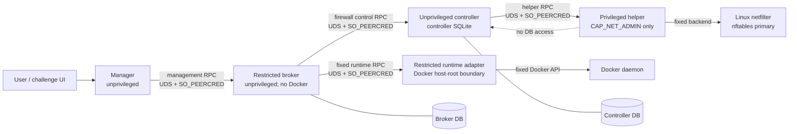
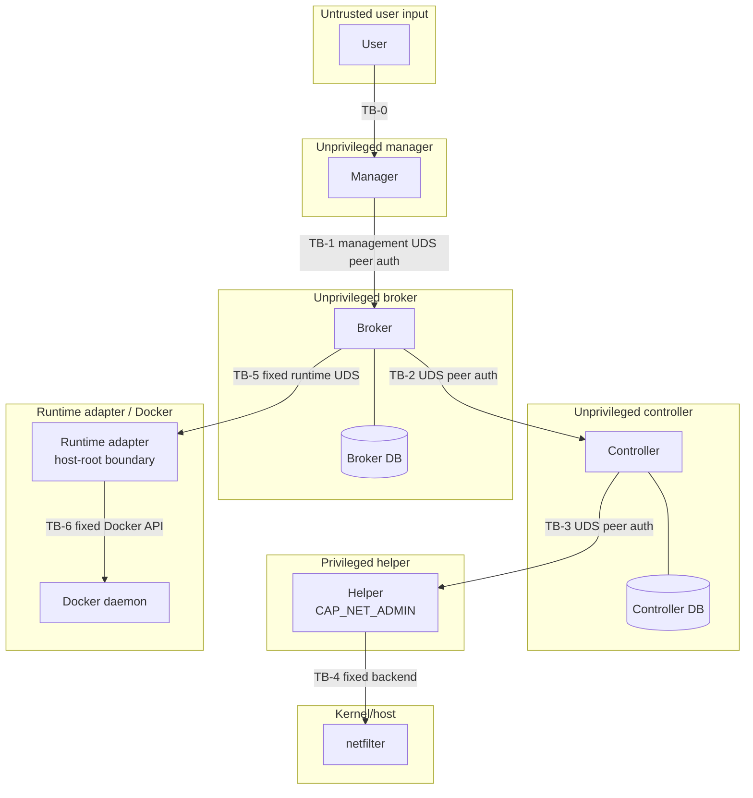

# Phase 2L.2H.5 — Implementation and Validation Roadmap

**Project:** Flaghunt CTF Platform  
**Repository:** `E:\Flag-hunt\ctf-platform-be`  
**Phase:** 2L.2H.5  
**Date:** 2026-11-13  
**Status:** **DESIGN ONLY — NO IMPLEMENTATION AUTHORIZED**  
**Integration gate:** **NOT READY — LIVE FIREWALL INTEGRATION NOT AUTHORIZED**  
**Remediation:** 2L.2I.2 documentation-only overlay, amended by 2L.2I.4; design decisions below
control where they conflict with earlier text. The validation roadmap includes the canonical
`rule-schema-v1` (2H.1 Section 4.4.1) and the `2750` setgid socket mechanism (2H.1 Section 5.1).
No runtime control is implemented.

This is the final Phase 2L.2H design document. It consolidates the target architecture, threat and
residual registers, privilege model, persistence/recovery design, deployment prerequisites, and a
future implementation/testing sequence. It does not authorize implementation, live transport,
capabilities, host firewall changes, Docker changes, deployment, or production use.

> **Current versus future.** The current implementation remains the Phase 2L.2G.3.11 local mock
> controller, reviewed as a scoped PASS only. The roadmap below is future work. No item in this
> document is complete merely because it is described here.

---

## 1. Current/target summary

| Area | Current verified state | Target proposal |
|---|---|---|
| Manager | Django/manager contract paths; lifecycle actions disabled or contract-only | Manager remains unprivileged and uses the restricted broker boundary |
| Broker | Loopback HTTP, Bearer token, test-only peer headers, clientless Docker adapter still wired to routes | Restricted broker; no firewall capability; direct-bind manager UDS; no Docker authority (N-04 open) |
| Controller | Local mock service with SQLite ownership/idempotency/evidence | Unprivileged UDS controller; independent validation/evidence/reconciliation |
| Helper | In-process `MockHelperExecutor` | Dedicated privileged helper, fixed enum, `CAP_NET_ADMIN` only |
| Runtime adapter | Broker clientless adapter + manager `DockerRuntimeAdapter` exported/mock-tested; no runtime service | Separate fixed-operation UDS service; only Docker socket user; host-root residual open |
| Transport | Mock/in-process | Direct-bind UDS with `SO_PEERCRED` on manager->broker, broker->controller, controller->helper, and broker->runtime |
| Firewall | Mock only | nftables primary; iptables/DOCKER-USER fallback |
| Persistence | Mock schema, single-family evidence | Per-family state/evidence, migration, integrity, full-scan reconciliation |
| Deployment | Development workspace | Ubuntu LTS systemd services, dedicated users, lab validation |
| Gate | **PASS local mock only** | **NOT READY — LIVE FIREWALL INTEGRATION NOT AUTHORIZED** |

The 3.11 review closed F-3.9-01/F-3.9-02, verified R-01/R-03 and R-02 (3.10 canonical scope) as
closed, and preserved the prior-phase mock findings F-01–F-09 (distinct from 2L.2I.1's
F-01–F-14). I-3.9-01, I-3.9-03, I-07, I-08, and
I-09 remain open informational residuals. This roadmap does not change those decisions.

---

## 2. Final architecture review

### 2.1 Consolidated architecture diagram

### 2.2 Consolidated trust-boundary diagram

### 2.3 Process and privilege matrix

| Process | User (UID/GID) | Capabilities | Socket role | Docker authority | DB access | Firewall mutation |
|---|---|---|---|---|---|---|
| Manager | `flaghunt-manager` (4600/4600) | None | Broker client | None | Manager only | No |
| Broker | `flaghunt-broker` (4601/4601) | None | Manager server / controller client / runtime client | **None** | Broker DB | No |
| Controller | `flaghunt-fwcontroller` (4602/4602) | None | Broker server / helper client | None | Controller DB | No |
| Helper | `flaghunt-fwhelper` (4603/4603) | `CAP_NET_ADMIN` only | Controller server | None | None | Yes, fixed backend |
| Runtime adapter | `flaghunt-runtime` (4604/4604) | None | Broker server | Rootful Docker socket | Runtime/catalog only | No firewall API |
| Kernel | n/a | n/a | n/a | n/a | n/a | n/a |

### 2.4 Protocol and operation contract summary

- Protocol name `flaghunt-local`; schema version `2L.2I.2`; protocol classes `management`,
  `firewall_control`, and `runtime`.
- All four local edges use direct-bind UDS with `SO_PEERCRED` UID/GID allowlists, immutable typed
  identity, bounded length-prefixed canonical JSON, one request/response per connection, exact
  version, unknown-field rejection, and sanitized errors. No HTTP/token fallback.
- Firewall operations: `HEALTH_CHECK`, `INSTALL_POLICY`, `INSPECT_POLICY`, `VERIFY_POLICY`,
  `REVOKE_POLICY`, `REMOVE_STALE_POLICY`, `RECONCILE_PENDING_OPERATIONS`.
- Management operations: `HEALTH_CHECK`, `PROVISION_INSTANCE`, `INSPECT_INSTANCE`,
  `STOP_INSTANCE`, `CLEANUP_INSTANCE`.
- Runtime operations: `RUNTIME_CREATE_INSTANCE`, `RUNTIME_START_INSTANCE`,
  `RUNTIME_INSPECT_INSTANCE`, `RUNTIME_STOP_INSTANCE`, `RUNTIME_REMOVE_INSTANCE`.
- Timeout field is `deadline_ms` (1..120000); `timeout_ms` and `ownership_record_id` are not target
  fields. Idempotency keys are global per receiver.
- Caller-supplied UID/GID/headers/PID/verified flags are not authentication. Test identity is
  test-only and never production-importable.
- The helper only executes typed enum operations; it never accepts shell commands, arbitrary
  executables, chain names, or raw rule text.
- The broker has no Docker socket; the runtime adapter is a separate host-root-equivalent
  boundary with fixed catalog-bound operations.
- `ACTIVE`/`REVOKED` require controller read-back and durable evidence; a helper response alone is
  insufficient.

Full contracts: 2H.1 Sections 4–5; backend/rule ownership: 2H.3; recovery: 2H.4.

### 2.5 Threat and residual registers

The full threat model is in `PHASE_2L_2H_2_THREAT_MODEL_AND_TRUST_BOUNDARIES.md`. The register
covers:

- unauthorized local process, local DoS, socket spoofing, UID/GID spoofing;
- replay, idempotency collisions, ownership substitution, information leakage;
- compromised manager/broker/controller/helper client, privilege escalation;
- concurrency, partial install/revoke, helper/controller crash, DB corruption, host restart;
- IPv4/IPv6 inconsistency, Docker interaction, arbitrary rule injection, audit tampering.

Carried/open residuals (not resolved):

| ID | Residual | Direction |
|---|---|---|
| RR-01 | `request_id` canonical scope | Mock validation + transport/schema validation |
| RR-02 | `operation_id` canonical scope | Mock validation + operation binding |
| RR-03 | `idempotency_key` canonical scope | Mock validation + uniqueness/digest binding |
| RR-04 | `policy_version` type/range | App rejection + DB constraint + migration |
| RR-05 | Full-scan reconciliation | Controller scan/all non-terminal states |
| RR-06 | I-3.9-01 missing digest DB `CHECK` | DB migration + app/helper validation |
| RR-07 | I-3.9-03 retained `__context__` | Error sanitization + logging/transport review |
| I-07 | Broader identifier/field scope | Universal schema validation across all fields and entries |
| I-08 | Raw `BrokerDBError` on non-failure paths | Sanitized error mapper on all persistence paths |
| I-09 | `strict_auth=False` legacy footgun | Remove from live path; production requires trusted identity |

The legacy mock register also remains open: `request_id`, `operation_id`, and `idempotency_key`
validation; non-SQLite-range/wrong-type `policy_version`; full-scan reconciliation limits; missing
DB digest `CHECK`; and Python exception-context retention. None is closed by this phase. Details
are in 2H.2 Section 6.

I-07, I-08, and I-09 are informational findings with Medium governance/security impact. Their owners
are, respectively, the universal-schema workstream, the persistence error-mapping workstream, and
the controller-authentication workstream. All three remain **OPEN — CLOSURE OR EXPLICIT ACCEPTANCE
REQUIRED**; this roadmap does not close them or treat a design statement as test evidence.

### 2.6 Database migration considerations summary

- Separate broker/controller databases; only the controller writes ownership/evidence.
- Add schema-version tracking, per-family state, per-family evidence, backend/helper provenance,
  canonical ID/digest/version constraints, and reconciliation state.
- `controller_idempotency` uses a **global** `idempotency_key` unique constraint; operation,
  canonical digest, authenticated principal, and ownership are bound columns.
- `controller_evidence` is append-only with update/delete triggers; family/ownership foreign keys
  use `ON DELETE RESTRICT`; aggregate `ACTIVE`/`REVOKED` invariants are enforced with CAS and a
  transaction/guard. `PARTIALLY_INSTALLED`/`PARTIALLY_REVOKED` are derived API statuses, not stored.
- Forward-only migrations; backup/integrity check; migrate on a copy; no silent backfill of
  legacy rows to `ACTIVE`; quarantine invalid/unknown records; restore-backup rollback.
- Full-scan reconciliation over all owned/non-terminal/uncertain records; unknown/unowned rules
  are reported, not deleted.

### 2.7 Deployment prerequisites summary

- Approved design/open decisions, Ubuntu LTS target, pinned kernel/nftables/Docker/runtime.
- Dedicated numeric users/groups (`4600`-`4605`), no-login helper, minimal capability proof,
  direct-bind server-owned `2750` setgid socket directories with kernel-inherited client groups
  and no supplementary-group access, systemd hardening/seccomp/MAC.
- Canonical `rule-schema-v1` validation/persistence/read-back with negative tests and no legacy
  helper/flat rule acceptance.
- **Broker and manager have no Docker socket/group/API/import/route**; the separate runtime adapter
  is the only Docker socket user and its host-root-equivalent residual (T-27) is explicitly
  accepted or removed. N-04 source authority must be gone.
- DB backup/integrity, monitoring/audit/disk bounds, boot ordering/reconciliation, upgrade/rollback
  drill.
- Disposable host lab and security review before any live integration.
- Current gate remains closed until explicit authorization.

### 2.8 Consistency and non-conflict rules

- The controller is the ownership/evidence authority; the broker does not mutate firewall state.
- The helper is the only `CAP_NET_ADMIN` process; the controller remains unprivileged.
- The manager is never a firewall authority.
- The broker and manager have no target Docker authority; the runtime adapter is a separate
  host-root-equivalent boundary with fixed catalog-bound operations and no firewall-control socket.
  Current broker/manager adapters keep N-04/T-27 open.
- All four local edges use direct-bind UDS with immutable `SO_PEERCRED` identity; there is no live
  HTTP/token identity path.
- Socket directories are `2750` setgid with exact owner/client group and sockets are `0660`; server
  group inheritance is kernel-provided and no server is in the client group.
- The protocol name/version/envelope/operations/timeouts/errors are exactly 2H.1 Sections 4-5;
  `ownership_record_id` and `timeout_ms` are not target fields; idempotency is global per receiver.
- The canonical rule schema is exactly 2H.1 Section 4.4.1; 2H.3 maps it to a backend and 2H.4
  persists it. No document or layer may add direction/state/DNS/ICMP fields or defaults.
- No success is inferred from a sent request or helper "ok"; read-back/evidence gate terminal
  states. `PARTIALLY_*` are derived, not persisted aggregate states.
- Current mock behavior is not live security proof.
- If any document or implementation assumption conflicts with these rules, the design must stop
  and be reconciled before implementation; no silent reinterpretation is permitted.

---

## 3. Recommended implementation sequence

No phase below is authorized by this document. Each phase requires explicit approval, a scoped
change plan, and its exit criteria. The sequence intentionally keeps live firewall changes until
after transport, validation, persistence, and lab controls are proven.

| Phase | Scope | Dependencies | Exit criteria | Live firewall? |
|---|---|---|---|---|
| 2H.0 | Approve design, resolve remaining open decisions, accept residual plan | This five-document set + 2L.2I.2 report | Architecture/threat/backend/persistence review approved; RTA/T-11/T-13 acceptance recorded; no unresolved design blocker | No |
| 2H.1 | Universal canonical validation and DB schema hardening in mock scope | 2H.0; backup/migration plan | RR-01..RR-04/RR-06 and I-07/I-08/I-09 tests; canonical `rule-schema-v1` negative tests; no regression in mock 3.11 suites; no live changes | No |
| 2H.2 | Shared `flaghunt-local`/`2L.2I.2` framed RPC library + test-only identity adapter + protocol contract tests | 2H.1; schema/operation contract | Framing/limits/schema/error/version tests; no production identity bypass; no real privileged helper | No |
| 2H.3 | Real direct-bind UDS manager->broker and broker->controller/helper with no-op/read-only helper in isolated lab | 2H.2; disposable Linux VM; test users; tmpfiles dirs | `SO_PEERCRED` allow/deny both ends, directory/socket perms, malformed/oversize/timeout, no backend mutation | No (lab only) |
| 2H.4 | Privileged helper skeleton, systemd hardening, capability proof, no host mutation | 2H.3; security review; capability lab | Minimal capability proven; no shell; seccomp/MAC profile; kill/restart behavior; no real rules | No (lab only) |
| 2H.5 | nftables backend in disposable network namespace/VM | 2H.4; nftables version pinned | Install/inspect/verify/revoke/ownership/rollback; IPv4/IPv6; unrelated rules preserved | Lab only |
| 2H.6 | Separated runtime adapter + Docker/DOCKER-USER integration lab | 2H.5; Docker version pinned; RTA acceptance | Broker has no Docker access; fixed operations; container restrictions/labels; hook/ordering/traffic tests; no Docker table flush; drift/reconcile; fallback criteria | Lab only |
| 2H.7 | Persistence/recovery/fault injection and full-scan reconciliation | 2H.5/2H.6; migration tests | Crash matrix, partial family, evidence invariants, DB corruption, disk full, restart, no false terminal state | Lab only |
| 2H.8 | Independent security review/penetration test | 2H.3-2H.7 | No unresolved critical/high findings; residual acceptance documented | Lab only |
| 2H.9 | Controlled single-instance pilot | 2H.8; operations/rollback/monitoring | Pilot exit criteria, incident drill, evidence review, explicit approval | Approved pilot only |
| 2H.10 | Production go/no-go | 2H.9; change control | All go criteria met; gate explicitly reopened | Only after approval |

### 3.1 Sequencing dependencies

- Do not implement manager->broker UDS before directory ownership/mode and `SO_PEERCRED` tests
  pass on all four edges.
- Do not implement real helper privilege before UDS peer auth and helper contract tests pass.
- Do not implement nftables mutation before ownership markers, read-back, evidence gating, and
  rollback design are proven in mock/lab.
- Do not implement the runtime adapter or test Docker integration before single-backend
  install/verify/revoke is reliable and the RTA residual is explicitly accepted.
- Do not run recovery tests without a disposable snapshot/rollback path.
- Do not deploy pilot before security review, monitoring, and operator runbooks are ready.

### 3.2 Recommended implementation order inside each phase

1. Write/adjust design and tests first; no production changes.
2. Add validation/schema changes with migration tests, including global idempotency and append-only
   evidence invariants.
3. Build the shared `flaghunt-local`/`2L.2I.2` protocol/client/server pieces with fail-closed
   defaults and test-only identity adapters.
4. Replace manager HTTP with direct-bind UDS; prove directory/socket modes and both-end peer checks.
5. Add no-op/read-only integration before mutation.
6. Add single-family backend, then dual-family parity.
7. Add the separated runtime adapter only after RTA acceptance and single-backend proof.
8. Add crash/fault injection, disk/audit bounds, and reconciliation.
9. Obtain independent review; then pilot.

---

## 4. Validation strategy

### 4.1 Test layers

| Layer | Scope | Example coverage | Environment | Gate |
|---|---|---|---|---|
| Unit | Pure validation/state/protocol | IDs, digest, policy version, family/CIDR/port, operation enum, framing lengths, forbidden identity fields, state transitions, global idempotency conflict, error sanitization | Local/unit, no privileged ops | 100% required cases, no skips |
| Integration | Manager/broker/controller/helper/runtime UDS pairs, mock/no-op, SQLite | Peer allow/deny both ends, directory/socket perms, schema, ownership resolution, evidence gating, reconciliation, per-family state, runtime labels | Disposable Linux VM; test users/sockets | All pass; fail closed |
| Security | Adversarial boundary tests | Wrong UID/GID, headers/JSON spoofing, socket replacement/symlink, replay, malformed/oversize, `SCM_RIGHTS`, shell/arg injection, path traversal, capability audit, info leak | Disposable Linux VM | No bypass; review sign-off |
| Fault injection | Crash/timeout/partial/DB/disk failures | Helper/controller/runtime crash at each boundary, lost response, partial v4/v6, DB busy/corrupt, disk full, restart, reconciliation | Disposable VM with snapshots | No false `ACTIVE`/`REVOKED`; recovery proven |
| Host validation | Real backend/Docker/OS behavior | nftables/iptables install/verify/revoke, IPv4/IPv6 parity, DOCKER-USER ordering, Docker restart, unrelated rule preservation, container restrictions/labels, reboot, upgrade/rollback | Isolated host lab/netns; no production | Host gate signed; rollback validated |

### 4.2 Required test cases

#### Transport and identity

- `SO_PEERCRED` UID/GID allowlist accepts only exact allowlisted peer on manager->broker,
  broker->controller, controller->helper, and broker->runtime.
- Missing/unavailable/malformed credentials fail closed; no HTTP/token fallback exists.
- Non-Linux/unsupported socket fails closed.
- `SOCK-05`/`PATH-05`: direct-bind directory owner/group/mode (`2750` setgid) and socket
  owner/group/mode (`0660`) drift is rejected; a `0750` directory fails; kernel setgid inheritance
  assigns the client group; cross-UID connect is denied; the client cannot write the directory; the
  server can bind/replace its own socket.
- Symlink/replacement/malicious server/live-socket collision is detected; client verifies server.
- Caller-supplied `X-Peer-*`, JSON `peer_uid/gid/pid`, `verified`, `caller_trusted`, or
  `ownership_record_id` are rejected; they are never accepted as authority.
- PID is audit-only; PID reuse cannot authorize.
- `SCM_RIGHTS`/ancillary data and inherited descriptors are rejected/closed.
- Supplementary-group assumptions are tested/rejected as designed.

#### Framing and schema

- Zero, negative, oversized (>65,536), truncated, trailing, invalid UTF-8/JSON, duplicate keys,
  non-object root rejected.
- Unknown fields/operations/classes/schema versions (`2L.2I.2` only) rejected before backend
  access; `2L.2G.3`, flat requests, `timeout_ms`, and `ownership_record_id` are rejected.
- Max depth/size/rule counts enforced; unknown fields are rejected, not stripped.
- `SCHEMA-01`/`SCHEMA-02`: every rule has exactly the eight `rule-schema-v1` fields; missing,
  duplicate, unknown, or defaulted family/direction/protocol/ports/action fields are rejected.
- `SCHEMA-03`: non-canonical/host-bit CIDRs, prefixes outside the owned network, /0, loopback,
  link-local, multicast, reserved, metadata, IPv4-mapped, invalid port types/ranges, and unknown
  actions are rejected; no CIDR masking or port widening occurs.
- `SCHEMA-04`: canonical rule/policy digests match the canonical JSON, array order is preserved,
  `compiled` mismatch/extra keys are rejected, and read-back is compared by digest and fields.
- `SCHEMA-05`: `icmp`, `icmpv6`, `any`, SCTP, and all unsupported protocols are rejected in v1;
  no all-protocol or all-port accept fallback exists.
- `deadline_ms` range and connection/worker limits enforced; timeout is uncertain.
- Global idempotency key conflict across operations/principal/payload enforced.
- Errors sanitized; no raw SQL/paths/tracebacks/request bodies.

#### Policy/ownership/backend

- Canonical IDs/digests/versions; bool/overflow/float/string rejection.
- CIDR/protocol/port/family validation; no `/0`, loopback/link-local/multicast/reserved/metadata,
  no IPv4-mapped IPv6, no all-port/all-protocol accept.
- Ownership marker exact match; unowned/unknown/mismatched chain cannot be installed/removed.
- Idempotent install/revoke; global key conflict/different digest/principal rejected.
- Read-back exactness; stale handles/digest mismatch not success.
- Unrelated host/Docker rules preserved; no flush; unknown rules reported, not deleted.
- IPv4/IPv6 parity; partial family cannot become `ACTIVE`/`REVOKED`; `PARTIALLY_*` are derived
  only.
- Broker/manager have no Docker socket/group/API/import/route; a source/import test proves
  `BrokerDockerAdapter`/`DockerRuntimeAdapter` cannot be reached from live routes and no Docker
  client is constructed. Runtime adapter accepts only fixed `RUNTIME_*` operations; arbitrary
  image/mount/command/privileged/host-namespace input rejected; ownership labels/spec digest
  verified; resource/network limits applied.
- Docker restart/ordering/drift, Docker socket isolation, and fallback DOCKER-USER behavior.

#### Lifecycle/persistence/recovery

- Evidence gating: no `ACTIVE` without per-family evidence; no `REVOKED` without absence evidence;
  `PARTIALLY_*` are derived, not persisted.
- Crash at each boundary in the matrix; no false terminal state.
- Full-scan reconciliation covers all owned/non-terminal/uncertain/legacy records.
- DB corruption/lock/disk-full fail closed; backup/restore path works; evidence update/delete is
  rejected; FK/CHECK/canonical constraints enforced.
- Global idempotency key scope and append-only evidence triggers tested.
- Host restart: rules absent/partial/stale → reconciliation, no unknown adoption.
- Concurrent operations: CAS/unique/serialization; no split-brain.
- Legacy migration: invalid/unknown rows quarantined, not auto-active.
- Residual tests RR-01..RR-07, I-07..I-09 explicit and non-skipped.

#### Privilege/deployment

- Helper has only `CAP_NET_ADMIN`; no root/shell/arbitrary exec; capabilities dropped on restart.
- Seccomp/MAC/read-only FS/no DB access; audit works.
- Broker has no Docker socket/group/API; runtime adapter is the only Docker socket user and
  cannot access firewall-control sockets; capability/group membership audited.
- systemd ordering, readiness, restart limits, shutdown drain, no rule removal on stop;
  tmpfiles-created direct-bind socket directories.
- Upgrade/rollback with backup, schema/version compatibility, reconciliation.
- Monitoring/alert/runbook exercises, including container drift and disk/audit exhaustion.

### 4.3 Test acceptance rules

- No skipped/blocked tests may be summarized as pass.
- A mock-only passing test does not satisfy a host-validation gate.
- Documentation edits do not close any High/Medium finding, RR, or I item; only executed tests and
  independent review can.
- Tests must assert the **negative** security behavior, not only success paths.
- Every high/critical threat control needs at least one adversarial test.
- Tests must be repeatable from a clean snapshot; no reliance on production state.
- Evidence from tests is archived with version/host details; failures block the phase.

---

## 5. Dependencies

### 5.1 Design and governance dependencies

- Approval of the five 2H documents plus the 2L.2I.2 remediation report, and
  resolution/acceptance of open decisions.
- Explicit residual risk acceptance for RR-01..RR-07, I-07..I-09, and high residual threats
  (controller compromise, `CAP_NET_ADMIN` helper compromise, runtime adapter host-root
  equivalence).
- Change control, security review, and operator approval for each future phase.
- Defined ownership of manager, broker, controller, helper, runtime adapter, host, Docker,
  network, and monitoring.

### 5.2 Technical dependencies

- Disposable Linux lab/VM(s) with snapshots and isolated network namespaces.
- Supported Ubuntu LTS, kernel, systemd, nftables, iptables fallback, Docker versions pinned.
- Dedicated numeric service users/groups (`4600`-`4605`), test identities, and read-only runtime
  catalog manifest.
- SQLite backup/integrity tooling and a restore drill.
- Fixed helper/runtime backend libraries; package checksum/signature verification; pinned image
  digests.
- Structured logging/metrics, independent audit destination, and bounded disk/retention.
- Test fixtures for TCP/UDP, IPv4/IPv6, Docker/`DOCKER-USER`, runtime labels/restrictions,
  malformed protocol, FD/ancillary data, and crash injection.
- No production credentials, production sockets, or production firewall access in test phases.

### 5.3 Cross-component dependencies

- Manager/broker `flaghunt-local`/`2L.2I.2` compatibility and lifecycle semantics.
- Broker/controller ownership and policy/compiler contract.
- Controller/helper frozen schema/version and evidence format.
- Broker/runtime adapter fixed operation contract and catalog manifest.
- Host/Docker networking, container restrictions, and hook-order validation.
- Deployment/service ordering, direct-bind socket lifecycle, and operator runbooks.

---

## 6. Go/no-go criteria

### 6.1 Go criteria for starting implementation

- All five 2H documents, the 2L.2I.2 report, the 2L.2I.4 remediation report, and the 2L.2I.5
  independent verification report reviewed and approved.
- Open decisions either resolved or explicitly deferred with risk acceptance.
- Threat model accepted; RR-01..RR-07 and I-07..I-09 have owners/plans; T-11/T-13/T-27
  acceptance recorded. N-01/N-02 host tests and N-04 source removal are not claimed complete.
- Disposable lab, rollback, and test plan approved.
- No unresolved critical architecture conflict.
- Explicit authorization to begin the next phase.

### 6.2 No-go conditions

- Any claim that mock/UDS scaffolding implements live security.
- Unresolved UDS peer identity, socket permission, helper privilege, or broker/Docker authority
  design.
- Any reintroduction of HTTP/token/test-header identity for manager->broker.
- No per-family evidence/full-scan reconciliation, append-only evidence, or global idempotency.
- nftables/Docker hook ordering untested, or a plan to flush shared tables.
- Runtime adapter residual not accepted, or the broker still has Docker socket/group/API access.
- Residuals treated as closed without tests.
- No rollback/restore, monitoring, or operator runbook.
- Any request to grant broad root/shell/capabilities beyond the approved helper.
- Any live firewall/Docker/host change attempted before the gate is explicitly reopened.

### 6.3 Live integration gate criteria

The live gate may be reopened only when all are true:

- [ ] 2H.0 design approval complete, including RTA/T-11/T-13 acceptance.
- [ ] Four direct-bind UDS edges pass peer auth/allowlists/`2750` setgid directory+`0660` socket
      modes/setgid inheritance/cross-UID deny/lifecycle/malformed-input/FD tests.
- [ ] Canonical `rule-schema-v1` controller/helper/backend/persistence/read-back tests pass; no
      legacy flat/`2L.2G.3` rule shape or ICMP fallback is accepted.
- [ ] Controller ownership/evidence/global idempotency and full-scan reconciliation prove no false
      `ACTIVE`/`REVOKED`; append-only evidence triggers pass.
- [ ] Helper minimal privilege/hardening verified in lab; no shell/arbitrary execution.
- [ ] nftables primary and iptables fallback host-validation tests pass; IPv4/IPv6 parity proven.
- [ ] Broker and manager have no Docker access or adapter route/import; runtime adapter fixed
      operations/restrictions/labels validated; Docker/`DOCKER-USER` interaction and
      restart/upgrade behavior validated.
- [ ] Crash/fault-injection and disk/audit exhaustion results satisfy the matrix.
- [ ] RR-01..RR-07 and I-07..I-09 closed or explicitly risk-accepted with evidence.
- [ ] Independent security review complete; no unresolved critical/high finding.
- [ ] Monitoring/audit/retention/runbooks and rollback drill complete.
- [ ] Controlled pilot exit criteria met.
- [ ] Explicit live integration authorization recorded.

Until then the only valid status is:

**NOT READY — LIVE FIREWALL INTEGRATION NOT AUTHORIZED**

### 6.4 Phase exit summary

| Phase | Go signal | No-go trigger |
|---|---|---|
| 2H.0 | Signed design review and residual acceptance | Open conflict/unaccepted high risk |
| 2H.1 | Validation/migration tests pass | Regression or unsafe backfill |
| 2H.2 | Protocol/version/negative tests pass | Identity accepted from payload/header or legacy schema |
| 2H.3 | Direct-bind UDS allow/deny/mode/framing pass on all edges | Any unauthenticated operation accepted |
| 2H.4 | Minimal capability/hardening proven | Root/shell/broad capability required |
| 2H.5 | nftables install/verify/revoke/rollback pass | Unrelated rules at risk |
| 2H.6 | RTA/Docker/IPv4/IPv6 host gate pass | Broker Docker access or ordering/drift unresolved |
| 2H.7 | Crash/restart/evidence/disk recovery pass | False terminal state possible |
| 2H.8 | Security review pass | Critical/high finding open |
| 2H.9 | Pilot/runbook/rollback pass | Operational uncertainty |
| 2H.10 | Explicit production approval | Gate not reopened |

---

## 7. Unresolved design decisions (consolidated)

**Resolved by 2L.2I.2 and completed by 2L.2I.4:** manager->broker is direct-bind UDS (no HTTP);
socket lifecycle is direct bind with tmpfiles-created server-owned `2750` setgid directories and
kernel-inherited client groups; service numeric IDs/allowlists are specified; protocol
name/version/envelope/operations/deadline/error registry and `rule-schema-v1` are frozen; partial
states are per-family derived; the design removes broker/manager Docker authority in favor of the
runtime adapter, with N-04 source removal still open. Supplementary-group access is not used.

Remaining decisions:

1. Helper native binary vs locked-down interpreter; exact supply-chain/seccomp/MAC.
2. Single helper vs split read-only helper.
3. Exact nftables table/hook priority and host-input/output scope.
4. No supplementary-group UDS policy: closed in design by the setgid-directory mechanism; any
   future non-UDS use requires a separate review.
5. Single controller/HA and reconciliation lease semantics.
6. Evidence signing/HMAC and key management.
7. Audit retention/tamper resistance and independent helper/runtime audit.
8. Boot baseline and pre-reconciliation exposure window.
9. Exact Ubuntu/kernel/nftables/Docker/runtime versions.
10. IPv6-disabled host policy and explicit one-family approval.
11. Migration rollback/downgrade policy.
12. Docker fallback trigger and whether both backends may coexist.
13. Runtime adapter manifest/image signing and explicit T-27 host-root residual acceptance.
14. T-11/T-13 host isolation, monitoring, and named risk-acceptance authority.

These remain open; the design does not guess them.

---

## 8. Final review checklist

| Required artifact | Where addressed | Status |
|---|---|---|
| Architecture diagram | 2H.1 Section 3; 2H.5 Section 2.1 | Documented |
| Trust-boundary diagram | 2H.1 Section 3.3; 2H.2 Section 2; 2H.5 Section 2.2 | Documented |
| Process/privilege matrix | 2H.1 Section 3.4; 2H.3 Section 5; 2H.5 Section 2.3 | Documented |
| Communication protocol | 2H.1 Sections 4–5; 2H.5 Section 2.4 | Documented |
| Operation contract | 2H.1 Section 4.4; 2H.3 Sections 3–4 | Documented |
| Canonical rule schema (`rule-schema-v1`) | 2H.1 Section 4.4.1; 2H.3 Section 3.3; 2H.4 Section 2.2; 2H.5 Section 4.2 | Documented; implementation/tests open |
| Socket group mechanism (`2750` setgid) | 2H.1 Section 5.1; 2H.3 Section 5.4; 2H.4 Sections 6.2–6.3 | Documented; host evidence open |
| N-01 through N-04 | 2H.2 Section 6.2; all five 2H docs; 2I.4 | Documented; N-04 open |
| Threat register (T-01..T-28) | 2H.2 Section 4 | Documented |
| Per-threat validation mapping | 2H.2 Section 4.3 | Documented |
| Residual-risk register | 2H.2 Section 6; 2H.5 Section 2.5 | Documented |
| I-07/I-08/I-09 + legacy mock register | 2H.2 Sections 6/6.1; 2H.5 Section 2.5 | Documented, open |
| Database migration considerations | 2H.4 Sections 2, 5; 2H.5 Section 2.6 | Documented |
| Deployment prerequisites | 2H.4 Section 8; 2H.5 Section 2.7 | Documented |
| Testing strategy | 2H.5 Section 4 | Documented |
| Implementation sequence/dependencies | 2H.5 Sections 3 and 5 | Documented |
| Go/no-go criteria | 2H.5 Section 6 | Documented |
| Current vs future separation | Every document | Documented |
| Open decisions | 2H.1, 2H.3, 2H.4, 2H.5 | Documented |
| Targeted blocker remediation | `PHASE_2L_2I_2_TARGETED_ARCHITECTURE_BLOCKER_REMEDIATION.md` | Documentation only |

### 8.1 Cross-document consistency rules

- All five documents must retain the exact current/target distinction.
- All five must identify the live gate as closed.
- Residual IDs RR-01..RR-07 and I-07..I-09 must remain open until evidence closes them; legacy
  mock residuals must not be silently closed.
- No document may claim the mock is a real transport or that mock tests prove live security.
- Protocol name/version, service IDs, socket paths/modes, operation names, timeout field, ownership
  field, idempotency scope, partial-state model, and broker Docker boundary must match 2H.1 and
  the 2I.2 report.
- Any future implementation change must update these documents and the gate; prose must not drift
  ahead of tested behavior.

---

## 9. Immediate next action

Stop after documentation creation. Do not implement, deploy, run privileged commands, create
sockets, grant capabilities, modify firewall/Docker, or alter host/service state. Await separate
explicit approval for a later phase.

**DESIGN COMPLETE — REAL FIREWALL IMPLEMENTATION NOT AUTHORIZED**

**NOT READY — LIVE FIREWALL INTEGRATION NOT AUTHORIZED**
